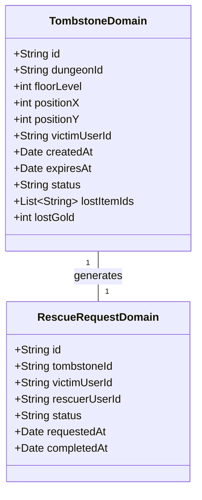

# ダンジョン救助・墓標システム仕様

## 1. 概要
本ドキュメントは、ローグライク型ダンジョン探索における死亡（倒伏）ペナルティの緩和および非同期マルチプレイヤー協力を提供する「ダンジョン救助・墓標システム（Dungeon Rescue & Tombstone System）」の仕様を定義します。

プレイヤーがダンジョン内で HP 0 に倒伏した際、所持品やゴールドの一部がその場に「墓標（Tombstone）」エンティティとして残され、他プレイヤー（救助隊）へ救助要請（Rescue Request）を発行できます。他プレイヤーが該当フロアへ到達し、墓標を守護する「守護霊（Guardian Spirit）」とのバトルに勝利することで、倒伏プレイヤーのロストアイテム・ゴールドの一部を復旧・還元し、救助者には専用報酬（救助の証、救助経験値）が付与されます。

---

## 2. 倒伏と墓標の生成メカニズム

### 2.1 倒伏（HP 0）時の挙動
1. **救助要請の選択**:
   - プレイヤーがダンジョン内で倒伏した際、即時「街への帰還（ロスト適用）」か「救助要請の発行（待機）」を選択します。
2. **墓標エンティティの設置**:
   - 救助要請を選択した場合、倒伏位置（座標 `x, y`, フロア `level`）に墓標オブジェクト（`Tombstone`）が動的に配置されます。
   - 墓標には倒伏プレイヤーのユーザーID、倒伏日時、ロストアイテム一覧、ロストゴールド量が一時格納されます。
3. **ロスト保護**:
   - 救助要請中のセーブデータは「救助待機状態」となり、救助完了または救助断念（諦め）が行われるまで対象キャラクターでの新規ダンジョン挑戦は制限されます。

### 2.2 墓標のステータスと寿命
- **救助期限**: 救助要請発行から **72時間（リアルタイム）**。
- **風化メカニズム**: 72時間が経過しても救助されなかった場合、墓標は「風化」して消失し、通常の死亡ペナルティ（所持金半減、一部アイテム消失）が確定適用されます。

---

## 3. 救助要請と救助探索メカニズム

### 3.1 救助掲示板（Rescue Board）
- 街の「救助ギルド」または API を通じて、他プレイヤーが発行したアクティブな救助要請一覧を照会できます。
- 救助要請には、対象ダンジョン、到達フロア、倒伏プレイヤー名、難易度（フロア階層・敵強力度）が表示されます。

### 3.2 救助探索のルール
- **救助派遣**: 救助者は「救助の巻物（`rescue_scroll`）」または「墓標の鍵（`tombstone_key`）」を所持して対象ダンジョンへ潜入します。
- **目標到達**: 倒伏者の発生フロアに到達し、墓標タイルにアクセスすることで「救助試練（守護霊戦）」が発火します。
- **自己救助（リトライ救助）**: 同一プレイヤーが別キャラクターまたは再挑戦で自身の墓標へ到達し、回収を行うことも可能です（この場合、専用の「供養の線香」が必要）。

---

## 4. 守護霊（Guardian Spirit）バトルと回収計算式

### 4.1 守護霊バトル
墓標に触れると、倒伏者の怨念やダンジョンの魔力が実体化した「墓標の守護霊（Guardian Spirit）」が出現します。
- **ステータス補正**: 倒伏者のレベルおよびフロア階層に応じた補正ステータスを持ちます。
- **勝利条件**: 守護霊を撃破することで救助成功となり、墓標が開放されます。

### 4.2 アイテム・ゴールド回収率計算式

救助成功時に復旧・還元される割合は以下の計算式で決定されます。

$$\text{回収率 (\%)} = \text{基本回収率 (70\%)} + \text{救助者評価補正 (最高 20\%)} + \text{使用アイテム補正 (10\%)}$$

- **アイテム回収順位**: 回収率に応じて、高レアリティおよび強化値の高い装備品・消費アイテムから優先的に救助袋へ回収されます。
- **救助者報酬**: 救助成功時、救助者には以下の報酬が即時授与されます。
  - **救助の証（`rescue_medal`）**: ギルドショップで貴重な錬金素材や限定装備と交換可能。
  - **救助 EXP**: 救助者ランクの上昇に寄与。
  - **ゴールド謝礼金**: 倒伏者の回収ゴールドの **15%** 相当（システムにより別途付与）。

---

## 5. 関連サポートアイテム仕様

救助システムを補助する専用アイテムを以下のように定義します。

| アイテム ID | 名称 | タイプ | 価値 | 効果説明 |
| :--- | :--- | :--- | :--- | :--- |
| `rescue_scroll` | 救助の巻物 | 消費 (`SCROLL`) | 1,200 Gold | 他プレイヤーの救助要請を受諾してダンジョンへ突入する際に必要な公式許可証。回収率 +10%。 |
| `offering_incense` | 供養の線香 | 消費 (`POTION`) | 800 Gold | 自身の過去の墓標へ到達した際に使用。守護霊の攻撃力を 20% 弱体化させる。 |
| `tombstone_key` | 墓標の鍵 | 消費 (`KEY`) | 2,500 Gold | 封印された高難易度ダンジョンの墓標を解錠し、確定で 100% のロストアイテムを回収可能にする鍵。 |
| `rescue_medal` | 救助の証 | 素材 (`MATERIAL`) | 非売品 | 救助成功時にギルドから授与されるメダル。特別アイテムとの交換に使用。 |

---

## 6. ドメインモデルおよびモジュール間連携

### 6.1 ドメインモデル構造



---

## 7. MongoDB 永続化仕様

### 7.1 `playerTombstoneDomain` コレクション (Dungeon モジュール)
- **説明**: ダンジョンフロア上に存在する墓標エンティティの永続化。
- **フィールド**: `_id`, `dungeonId`, `floorLevel`, `positionX`, `positionY`, `victimUserId`, `lostItemIds`, `lostGold`, `status` (`ACTIVE`, `RESCUED`, `EXPIRED`, `ABANDONED`), `createdAt`, `expiresAt`.
- **インデックス**:
  - `{"dungeonId": 1, "floorLevel": 1, "status": 1}`: フロア配置墓標の高速検索。
  - `{"victimUserId": 1, "status": 1}`: プレイヤーの倒伏墓標照会用。
  - `{"expiresAt": 1}`: TTL / 期限切れ風化クリーンアップ用。

### 7.2 `rescueRequestDomain` コレクション (BookOfAdventure モジュール)
- **説明**: 救助要請および救助マッチング履歴の永続化。
- **フィールド**: `_id`, `tombstoneId`, `victimUserId`, `rescuerUserId`, `status` (`PENDING`, `IN_PROGRESS`, `SUCCESS`, `FAILED`, `CANCELLED`), `requestedAt`, `completedAt`.
- **インデックス**:
  - `{"status": 1, "requestedAt": -1}`: 救助掲示板アクティブ要請一覧用。
  - `{"victimUserId": 1}`: 自身宛て救助状態照会用。

---

## 8. REST API 仕様

### 8.1 救助要請一覧照会 API
- **Endpoint**: `GET /api/v1/dungeons/rescue/requests`
- **Query Parameters**: `status` (default: `PENDING`), `page`, `limit`
- **Response Body (JSON - 成功時)**:
```json
{
  "success": true,
  "requests": [
    {
      "requestId": "res_req_88192",
      "tombstoneId": "tomb_99102",
      "victimUserId": "usr_player_alpha",
      "victimName": "アリス",
      "dungeonId": "ancient_cave",
      "dungeonName": "古代の洞窟",
      "floorLevel": 15,
      "lostItemCount": 8,
      "lostGold": 4500,
      "requestedAt": "2025-02-28T10:00:00Z",
      "expiresAt": "2025-03-03T10:00:00Z"
    }
  ],
  "total": 1
}
```

### 8.2 救助要請作成 API
- **Endpoint**: `POST /api/v1/dungeons/rescue/requests`
- **Request Body (JSON)**:
```json
{
  "userId": "usr_player_alpha",
  "dungeonId": "ancient_cave",
  "floorLevel": 15,
  "positionX": 12,
  "positionY": 8,
  "lostItemIds": ["item_inst_11", "item_inst_12"],
  "lostGold": 4500
}
```

- **Response Body (JSON - 成功時)**:
```json
{
  "success": true,
  "requestId": "res_req_88192",
  "tombstoneId": "tomb_99102",
  "status": "PENDING",
  "message": "救助要請を発行しました。他プレイヤーの救助を待ちます。"
}
```

### 8.3 救助実行・守護霊戦開始 API
- **Endpoint**: `POST /api/v1/dungeons/rescue/execute`
- **Request Body (JSON)**:
```json
{
  "rescuerUserId": "usr_player_beta",
  "requestId": "res_req_88192",
  "useItemId": "rescue_scroll"
}
```

- **Response Body (JSON - 成功時)**:
```json
{
  "success": true,
  "requestId": "res_req_88192",
  "status": "IN_PROGRESS",
  "guardianSpirit": {
    "entityId": "guardian_spirit_99102",
    "name": "墓標の守護霊",
    "level": 18,
    "hp": 350,
    "atk": 45,
    "def": 30
  }
}
```

### 8.4 救助完了・報酬受領 API
- **Endpoint**: `POST /api/v1/dungeons/rescue/claim`
- **Request Body (JSON)**:
```json
{
  "rescuerUserId": "usr_player_beta",
  "requestId": "res_req_88192",
  "isGuardianDefeated": true
}
```

- **Response Body (JSON - 成功時)**:
```json
{
  "success": true,
  "requestId": "res_req_88192",
  "status": "SUCCESS",
  "recoveryRate": 80,
  "recoveredItems": [
    {"typeId": "iron_sword", "quantity": 1},
    {"typeId": "magic_pot", "quantity": 1}
  ],
  "recoveredGold": 3600,
  "rescuerRewards": {
    "rescueMedals": 3,
    "rescueExp": 150,
    "bonusGold": 675
  }
}
```

---

## 9. エラーハンドリング (Error Handling)

| エラーコード | 発生条件 | レスポンス HTTP ステータス | 戻り値のメッセージ例 |
| :--- | :--- | :---: | :--- |
| `RESCUE_REQUEST_NOT_FOUND` | 指定された `requestId` の救助要請が存在しない。 | 404 Not Found | 該当する救助要請が見つかりません。 |
| `TOMBSTONE_NOT_FOUND` | 対応する墓標オブジェクトが存在しない。 | 404 Not Found | 墓標データが存在しません。 |
| `RESCUE_ALREADY_COMPLETED` | 対象の救助要請はすでに救助完了している。 | 400 Bad Request | この救助要請はすでに完了しています。 |
| `RESCUE_EXPIRED` | 72時間の救助期限が経過し、風化している。 | 400 Bad Request | 救助期限が切れ、墓標は風化しました。 |
| `CANNOT_RESCUE_SELF` | 自身で発行した救助要請に対して通常の救助の巻物で受諾しようとした。 | 400 Bad Request | 自身の救助には供養の線香が必要です。 |
| `INSUFFICIENT_RESCUE_ITEM` | 救助実行に必要な「救助の巻物」または「墓標の鍵」を所持していない。 | 400 Bad Request | 救助に必要なアイテムを所持していません。 |
| `GUARDIAN_SPIRIT_NOT_DEFEATED` | 守護霊の撃破が完了していない状態で報酬受領を行おうとした。 | 400 Bad Request | 守護霊がまだ撃破されていません。 |
