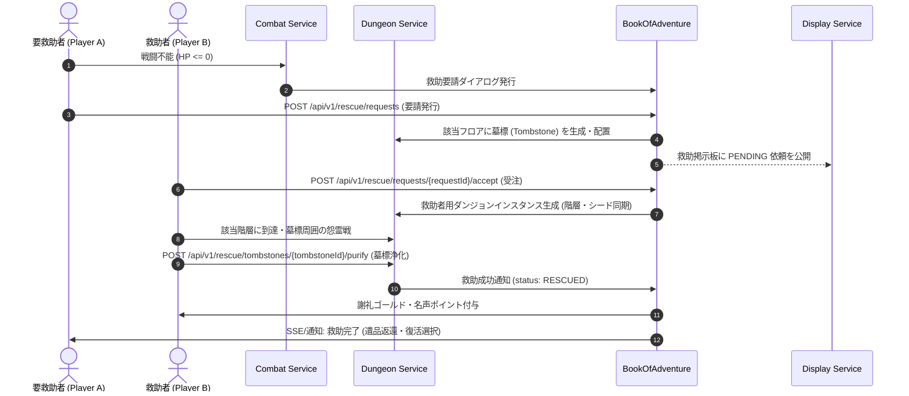

# ダンジョン救助・墓標システム仕様 (Dungeon Rescue & Tombstone System)

## 1. システム概要
本ドキュメントは、ダンジョン探索中に力尽きた（HP 0）プレイヤーを他のプレイヤーが探索・救出、あるいは倒れた地点に残された「墓標（Tombstone）」を巡るソーシャル・救済ゲームメカニズム「**ダンジョン救助・墓標システム**」の仕様を定義します。

### 1.1 背景と設計思想
- **ロスト体験の緩和とエンゲージメント**:
  従来のローグライクにおける全ロストの理不尽さを、他プレイヤーへの救助依頼（レスキューシステム）によってソーシャルな協力プレイへと転換します。
- **ハイリスク・ハイリターンの救助ミッション**:
  救助者は要救助者が倒れた正確な階層・シード値のダンジョンへ潜入し、墓標を取り囲む怨霊・守護モンスターを排除して救助を完了します。
- **非対称ダンジョン運営との融合**:
  ダンジョン管理者は自身のダンジョン内で発生した救助劇をリアルタイムに観戦・介入でき、救助成功時にはダンジョン評価（いいね）や名声ボーナスが付与されます。

---

## 2. コアゲームメカニクス

### 2.1 プレイヤー倒伏と救助要請 (Collapse & Rescue Request)
1. **倒伏発生**:
   - プレイヤーがダンジョン内で HP 0 に達した際、即座のデスペナルティ適用（諦めて帰還）か、世界全体（またはフレンド・ギルド）への**「救助要請 (Rescue Request)」**発行かを選択します。
2. **墓標（Tombstone）の設置**:
   - 救助要請を選択すると、倒れたフロアの座標に `Tombstone` オブジェクトが生成されます。
   - プレイヤーが落とした装備品・アイテム・ゴールドの一部（または全部）が墓標内部の遺品スロットに一時保管されます。
3. **救助要請の有効期限**:
   - 救助要請は作成からリアルタイムで **48時間** 有効です。
   - 期限切れ（`EXPIRED`）となった場合、通常のデスペナルティが確定適用され、墓標の遺品はダンジョン管理者へ還元（または消滅）します。

### 2.2 救助ミッションの受注と潜入 (Acceptance & Infiltration)
1. **救助掲示板 (Rescue Board)**:
   - 町の掲示板またはメニューから、現在救援を求めている救助依頼一覧（要救助者名、対象ダンジョン、フロア階層、提示された謝礼ゴールド、難易度）を閲覧・受注できます。
2. **救助ダンジョンへの潜入**:
   - 救助者は該当ダンジョンの 1 階（または中間拠点）からスタートし、要救助者が倒れた指定階層の墓標座標を目指します。
   - 救助中は脱出の巻物等による任意帰還が制限され、墓標の解放または全滅によってのみミッションが終了します。

### 2.3 墓標解放戦と怨霊・守護モンスター (Tombstone Guardian Battle)
1. **怨霊の出現**:
   - 墓標の周囲 3x3 タイルに到達すると、倒れたプレイヤーの無念が具現化した「怨霊（Vengeful Spirit）」またはダンジョン内の強力な守護モンスター群が召喚されます。
2. **墓標の浄化と解放**:
   - 周囲の敵をすべて殲滅するか、特殊アイテム「供養のお香（`offering_incense`）」または「墓標の鍵（`tombstone_key`）」を使用することで、墓標の浄化（Purification）が完了します。
3. **救助成立**:
   - 墓標が浄化されると即座に救助成立（`RESCUED`）となり、要救助者へ通知（SSE/ゲーム内メール）が送られます。救助者は町へ安全にテレポート帰還します。

### 2.4 報酬と感謝の印 (Rewards & Gratitude)
1. **救助者の報酬**:
   - 依頼主があらかじめ設定した「謝礼ゴールド」。
   - システムから付与される「救助名声ポイント (Rescue Honor Points)」。
   - 救助実績・称号の進捗加算（例：「歴戦の救助隊長」）。
2. **要救助者の復活と遺品返還**:
   - 要救助者は次回のログイン時、または拠点にて、ロストを免れた装備・アイテム・ゴールド一式を受け取り、直前ダンジョン階層から再開するか拠点へ無傷で生還するかを選択できます。
   - 要救助者から救助者へ「感謝のお礼アイテム（お礼の手紙や貴重な触媒）」を任意で送付可能です。

---

## 3. ドメインモデル仕様

### 3.1 `TombstoneDomain` (墓標エンティティ)
ダンジョンフロア上の特定の座標に配置される墓標のデータ構造です。

```java
public record TombstoneDomain(
    String tombstoneId,
    String rescueRequestId,
    String deceasedPlayerId,
    String deceasedPlayerName,
    Coordinate2D position,
    int floorLevel,
    List<String> preservedItemInstanceIds,
    int preservedGold,
    boolean isPurified,
    long collapsedAt
) {}
```

### 3.2 `RescueRequestDomain` (救助リクエストエンティティ)
システム全体で共有・管理される救助依頼のライフサイクルオブジェクトです。

```java
public record RescueRequestDomain(
    String requestId,
    String requesterId,
    String requesterName,
    String dungeonId,
    String dungeonName,
    int floorLevel,
    Coordinate2D tombstonePosition,
    RescueStatus status,
    String rescuerId,
    String rescuerName,
    int rewardGold,
    long createdAt,
    long expiresAt,
    long completedAt
) {}
```

### 3.3 `RescueStatus` (ステータス列挙型)
- `PENDING`: 救援募集中。誰でも受注可能。
- `IN_PROGRESS`: 特定の救助者が受注しダンジョン攻略中（排他ロック。一定時間放置で PENDING に自動復帰）。
- `RESCUED`: 救助成功。要救助者への返還準備完了。
- `EXPIRED`: 制限時間（48時間）経過による失効。
- `CANCELLED`: 要救助者本人が救助を断念し、通常のデスペナルティを受け入れて帰還。

---

## 4. 救助関連アイテム

Objectsモジュールで定義される専用アイテムです。

| ID | 名称 | カテゴリ | 価格 | ティア | 表示 | 効果・補正 |
| :--- | :--- | :--- | :---: | :---: | :---: | :--- |
| `rescue_scroll` | 救助要請の巻物 | `SCROLL` | 1000 | 2 | `?` | 倒伏時に持っていると、死亡ペナルティ保留と優先救助依頼を即座に発行可能。 |
| `offering_incense` | 供養のお香 | `POTION` | 1200 | 2 | `!` | 墓標周囲で使用すると怨霊を鎮め、戦闘をスキップして墓標を即時浄化・解放する。 |
| `tombstone_key` | 墓標の鍵 | `OTHER` | 2000 | 3 | `k` | 封印された高難易度墓標を素早く解錠し、全遺品を完全な状態で回収・返還する。 |

---

## 5. モジュール間連携シーケンス



---

## 6. REST API 仕様

### 6.1 救助依頼一覧照会 (`GET /api/v1/rescue/requests`)
掲示板に掲載されているアクティブな救助依頼を一覧取得します。

#### クエリパラメータ
- `status` (任意): `PENDING`, `IN_PROGRESS`, `RESCUED`
- `dungeonId` (任意): 特定のダンジョンに絞り込み
- `limit` (デフォルト: 20): 取得件数上限

#### レスポンス JSON スキーマ (200 OK)
```json
{
  "requests": [
    {
      "requestId": "rescue_req_88129",
      "requesterId": "usr_alpha_101",
      "requesterName": "シレン隊長",
      "dungeonId": "dungeon_frontier_01",
      "dungeonName": "試練の洞窟",
      "floorLevel": 15,
      "tombstonePosition": { "x": 14, "y": 22 },
      "status": "PENDING",
      "rewardGold": 3000,
      "createdAt": "2026-04-01T10:00:00Z",
      "expiresAt": "2026-04-03T10:00:00Z"
    }
  ],
  "totalCount": 1
}
```

---

### 6.2 救助要請の発行 (`POST /api/v1/rescue/requests`)
戦闘不能となったプレイヤーが救助を要請し、墓標を生成します。

#### リクエスト JSON スキーマ
```json
{
  "userId": "usr_alpha_101",
  "dungeonId": "dungeon_frontier_01",
  "floorLevel": 15,
  "deathPosition": { "x": 14, "y": 22 },
  "rewardGold": 3000
}
```

#### レスポンス JSON スキーマ (201 Created)
```json
{
  "requestId": "rescue_req_88129",
  "tombstoneId": "tomb_dungeon_frontier_01_15_usr_alpha_101",
  "status": "PENDING",
  "rewardGold": 3000,
  "expiresAt": "2026-04-03T10:00:00Z",
  "message": "救助要請が全サーバーに発行され、墓標が建立されました。"
}
```

---

### 6.3 救助依頼の受注 (`POST /api/v1/rescue/requests/{requestId}/accept`)
救助者が特定の救助依頼を引き受け、攻略を開始します。

#### リクエスト JSON スキーマ
```json
{
  "rescuerId": "usr_rescuer_999"
}
```

#### レスポンス JSON スキーマ (200 OK)
```json
{
  "requestId": "rescue_req_88129",
  "status": "IN_PROGRESS",
  "rescuerId": "usr_rescuer_999",
  "targetDungeonId": "dungeon_frontier_01",
  "targetFloorLevel": 15,
  "timeoutSeconds": 3600
}
```

---

### 6.4 墓標の浄化と救助完了 (`POST /api/v1/rescue/tombstones/{tombstoneId}/purify`)
救助者が墓標に到達し、守護怨霊を排除して浄化を実行します。

#### リクエスト JSON スキーマ
```json
{
  "rescuerId": "usr_rescuer_999",
  "catalystItemId": "offering_incense"
}
```

#### レスポンス JSON スキーマ (200 OK)
```json
{
  "tombstoneId": "tomb_dungeon_frontier_01_15_usr_alpha_101",
  "status": "RESCUED",
  "rewardGoldAwarded": 3000,
  "honorPointsAwarded": 150,
  "deceasedPlayerRescued": "シレン隊長",
  "timestamp": "2026-04-01T11:30:00Z"
}
```

---

### 6.5 救助報酬・生還処理 (`POST /api/v1/rescue/requests/{requestId}/claim`)
救助完了後、要救助者が拠点または次回到達時に遺品を受け取り復活します。

#### リクエスト JSON スキーマ
```json
{
  "userId": "usr_alpha_101",
  "revivalOption": "RETURN_TO_TOWN"
}
```

#### レスポンス JSON スキーマ (200 OK)
```json
{
  "requestId": "rescue_req_88129",
  "restoredItemCount": 18,
  "restoredGold": 5200,
  "revivalLocation": "TOWN",
  "timestamp": "2026-04-01T12:00:00Z"
}
```

---

## 7. エラーハンドリング仕様

| エラーコード | HTTPステータス | 発生条件・説明 |
| :--- | :---: | :--- |
| `RESCUE_REQUEST_NOT_FOUND` | `404 Not Found` | 指定された `requestId` の救助依頼が存在しない場合。 |
| `TOMBSTONE_NOT_FOUND` | `404 Not Found` | 指定された `tombstoneId` の墓標が存在しない場合。 |
| `CANNOT_RESCUE_SELF` | `400 Bad Request` | 自分自身が発行した救助依頼を受託しようとした場合。 |
| `RESCUE_REQUEST_ALREADY_ACCEPTED` | `409 Conflict` | 他のプレイヤーがすでに該当の救助依頼を受託し攻略中である場合。 |
| `RESCUE_REQUEST_EXPIRED` | `410 Gone` | 救助要請の制限時間（48時間）が経過し失効している場合。 |
| `INSUFFICIENT_REWARD_GOLD` | `400 Bad Request` | 救助要請時に設定した謝礼ゴールドが所持金を超えている場合。 |
| `TOMBSTONE_ALREADY_PURIFIED` | `409 Conflict` | 対象の墓標がすでに浄化・救助済みである場合。 |
| `GUARDIAN_MONSTERS_ALIVE` | `400 Bad Request` | 墓標周囲の怨霊・守護モンスターが残存しており、即時浄化アイテムも未所持である場合。 |
| `INVALID_REVIVAL_OPTION` | `400 Bad Request` | 不正な復活オプション（`RETURN_TO_TOWN`, `CONTINUE_FLOOR` 以外）が指定された場合。 |
| `UNAUTHORIZED_RESCUE_OPERATOR` | `403 Forbidden` | 依頼主以外のユーザーが救助完了遺品の回収を試みた場合。 |
