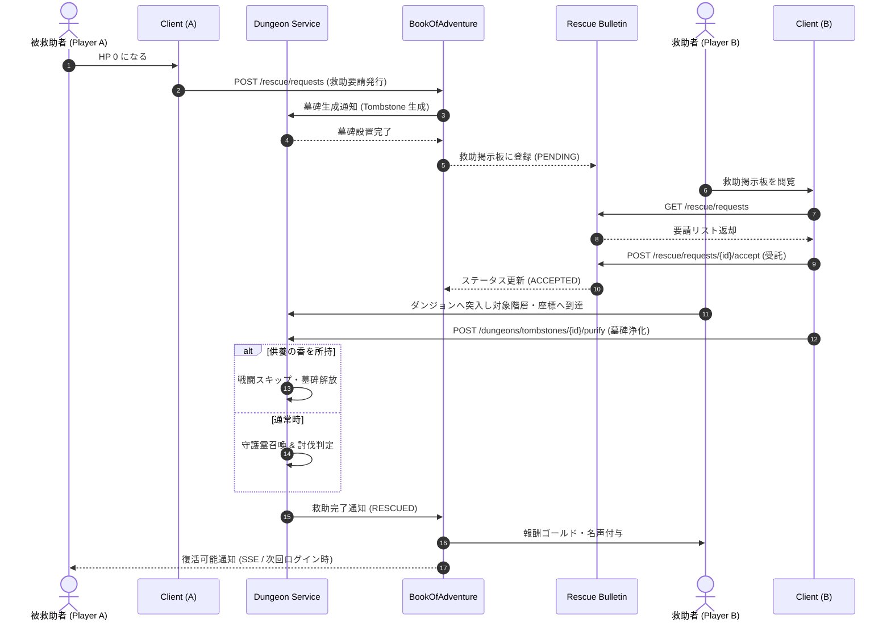

# ダンジョン救助・墓碑システム仕様 (Dungeon Rescue & Tombstone System)

## 1. 概要
本システムは、ダンジョン探索中にプレイヤーがHP 0となり倒れた（力尽きた）際、直ちに全滅・デスペナルティを受けるのではなく、他の冒険者（他プレイヤー）へ救援を求める「救助要請」の発行と、倒れた座標に生成される「墓碑（Tombstone）」を通じた非同期マルチプレイ相互支援メカニズムを定義します。

救助者はダンジョンへ突入して対象フロアの墓標に到達し、「守護霊バトル」または「供養・解放の儀式」を成功させることで倒れたプレイヤーを救助できます。救助されたプレイヤーはそのフロア・その場で復活（またはロスト回避して町へ生還）でき、救助者にはゴールド・名声・感謝の報酬が付与されます。

---

## 2. コアコンセプトと救助サイクル

### 2.1 プレイヤー倒伏時の選択肢
探索中にプレイヤーのHPが0になった際、クライアント画面に以下の選択肢が表示されます。

| 選択肢 | 動作概要 | 適用結果 |
| :--- | :--- | :--- |
| **通常死亡（諦める）** | ダンジョンの通常デスペナルティ設定を即時適用し、拠点へ強制送還される。 | アイテム没収・ゴールド喪失・経験値減少等の通常ペナルティ。 |
| **救助要請を発行する** | そのフロアの倒伏座標に「墓碑（Tombstone）」を固定配置し、救助掲示板へ要請を発行する。 | セーブデータは「救助待機状態（RESCUE_WAITING）」となり、救助完了まで該当ダンジョンへは再突入不可。 |

- **要請期限（TTL）**: 救助要請の発行から **実時間48時間**。期限内に救助者が現れなかった場合は通常死亡ペナルティが適用され強制精算されます。
- **同一ダンジョン挑戦中の要請回数制限**: 1回のダンジョン挑戦につき最大 **3回** まで救助要請可能。

### 2.2 墓碑（Tombstone）の性質と守護霊
- **フロアへの配置**: プレイヤーが倒れたタイルの座標に、特殊オブジェクト `Tombstone` が生成されます。
- **守護霊（Guardian Spirit）**: 倒れたプレイヤーの魂が未練によってモンスター化、または悪霊が取り憑いた状態。
  - 救助者が墓碑に接触した際、救助難易度に応じた「守護霊バトル」が発生します。
  - または、消費アイテム「供養の香（`offering_incense`）」を所持している場合は、戦闘をスキップして即座に墓標を浄化・解放可能です。
- **遺品保護**: 倒れたプレイヤーが持っていたインベントリ内のアイテムおよび所持金の一部は墓碑内に安全に封印されており、通常死亡のように管理者に全没収されることはありません。

### 2.3 救助成功時の報酬とインセンティブ
救助に成功したプレイヤー（救助者）は以下の特典を獲得します。
1. **救助報酬金（Bounty Gold）**: 要請者が設定した預かり金（最低 500 G、プレイヤーが任意上乗せ可能）。
2. **冒険者ギルド名声（Guild Rep）**: 救助完了数に応じた名声ポイント獲得（実績や称号解禁に連動）。
3. **感謝の印（Gift Item）**: 救助された側が救助完了通知受信時に、お礼の手紙とともにアイテムを1つ贈呈可能。

---

## 3. ドメインモデル定義

### 3.1 `TombstoneDomain` (ダンジョンフロア上の墓碑エンティティ)
- **パッケージ**: `net.hero.rogueb.dungeon.domain`
- **主要プロパティ**:
  - `tombstoneId` (String): 墓碑の一意なID。
  - `rescueRequestId` (String): 紐づく救助要請ID。
  - `dungeonId` (String): ダンジョンID。
  - `floorLevel` (Integer): 倒伏フロア階層。
  - `position` (Coordinate): 倒伏タイルの座標。
  - `ownerUserId` (String): 倒れたプレイヤーのID。
  - `ownerPlayerName` (String): 倒れたプレイヤー名。
  - `causeOfDeath` (String): 死因（例: `MONSTER:dragon_001`, `TRAP:trap_landmine_01`）。
  - `sealedGold` (Integer): 墓碑内に保護された所持金。
  - `sealedItemCount` (Integer): 墓碑内に保護されたアイテム数。
  - `isPurified` (Boolean): 浄化・解放済みフラグ。
  - `createdAt` (Long): 生成日時タイムスタンプ。

### 3.2 `RescueRequestDomain` (救助要請エンティティ)
- **パッケージ**: `net.hero.rogueb.bookofadventure.domain`
- **主要プロパティ**:
  - `requestId` (String): 要請の一意なID。
  - `targetUserId` (String): 救助を待つプレイヤーID。
  - `targetPlayerName` (String): プレイヤー名。
  - `dungeonId` (String): ダンジョンID。
  - `dungeonName` (String): ダンジョン名。
  - `floorLevel` (Integer): 到達していた階層。
  - `rewardGold` (Integer): 救助者に支払われる報酬ゴールド。
  - `status` (RescueStatus): 救助ステータス。
    - `PENDING`: 掲示板に掲示され、救助者を募集中。
    - `ACCEPTED`: 救助者が受託し、救助に向かっている最中。
    - `RESCUED`: 救助に成功し、墓碑が解放された。
    - `EXPIRED`: 制限時間（48時間）が経過し失効。
    - `CANCELLED`: 要請者が自ら諦めて通常死亡を受け入れた。
  - `rescuerUserId` (String): 受託・救助したプレイヤーID（未受託時は null）。
  - `rescuerPlayerName` (String): 救助者プレイヤー名。
  - `expiresAt` (Long): 有効期限タイムスタンプ。
  - `createdAt` (Long): 要請発行日時タイムスタンプ。
  - `completedAt` (Long): 救助完了日時タイムスタンプ。

---

## 4. モジュール間シーケンス連携



---

## 5. REST API仕様

### 5.1 救助要請の発行 (`POST /api/v1/rescue/requests`)
ダンジョン内で倒れたプレイヤーが救助要請を発行します。

#### リクエスト (Request)
```json
{
  "userId": "usr_victim_001",
  "dungeonId": "dungeon_frontier_01",
  "floorLevel": 7,
  "coordinate": { "x": 14, "y": 9, "z": 0 },
  "causeOfDeath": "MONSTER:inferno_dragon_01",
  "rewardGold": 1500
}
```

#### レスポンス (Response: 201 Created)
```json
{
  "requestId": "res_req_88192031",
  "status": "PENDING",
  "dungeonId": "dungeon_frontier_01",
  "floorLevel": 7,
  "rewardGold": 1500,
  "expiresAt": 1775088000000,
  "createdAt": 1774915200000
}
```

---

### 5.2 救助掲示板一覧照会 (`GET /api/v1/rescue/requests`)
救助者を募集中のアクティブな要請一覧を取得します。

#### クエリパラメータ
- `dungeonId` (任意): 特定ダンジョンに絞り込み。
- `minLevel` (任意): 最低階層。
- `maxLevel` (任意): 最高階層。
- `limit` (デフォルト: 20): 取得件数。

#### レスポンス (Response: 200 OK)
```json
{
  "requests": [
    {
      "requestId": "res_req_88192031",
      "targetUserId": "usr_victim_001",
      "targetPlayerName": "Aragorn",
      "dungeonId": "dungeon_frontier_01",
      "dungeonName": "試練の洞窟",
      "floorLevel": 7,
      "rewardGold": 1500,
      "status": "PENDING",
      "expiresAt": 1775088000000
    }
  ],
  "totalCount": 1
}
```

---

### 5.3 救助要請の受託 (`POST /api/v1/rescue/requests/{requestId}/accept`)
救助者が特定の要請を引き受けます。

#### リクエスト (Request)
```json
{
  "rescuerUserId": "usr_rescuer_007"
}
```

#### レスポンス (Response: 200 OK)
```json
{
  "requestId": "res_req_88192031",
  "status": "ACCEPTED",
  "rescuerUserId": "usr_rescuer_007",
  "acceptedAt": 1774920000000
}
```

---

### 5.4 墓標の浄化・解放処理 (`POST /api/v1/dungeons/tombstones/{tombstoneId}/purify`)
救助者が該当フロアの墓標に到達し、浄化または守護霊の鎮魂を実行して救助を完了させます。

#### リクエスト (Request)
```json
{
  "rescuerUserId": "usr_rescuer_007",
  "useOfferingIncense": true
}
```

#### レスポンス (Response: 200 OK)
```json
{
  "tombstoneId": "tomb_dungeon_frontier_01_07_01",
  "requestId": "res_req_88192031",
  "isPurified": true,
  "skippedCombat": true,
  "rewardGoldGranted": 1500,
  "rescuerReputationGained": 25,
  "completedAt": 1774925000000
}
```

---

### 5.5 被救助者の復活・生還処理 (`POST /api/v1/rescue/requests/{requestId}/revive`)
救助完了後、被救助者プレイヤーがゲームを再開する際の復帰処理です。

#### リクエスト (Request)
```json
{
  "userId": "usr_victim_001",
  "choice": "RESUME_DUNGEON"
}
```
※ `choice`: `RESUME_DUNGEON`（倒れた階層から続行）または `RETURN_TO_TOWN`（全所持品を保ったまま町へ無事帰還）。

#### レスポンス (Response: 200 OK)
```json
{
  "requestId": "res_req_88192031",
  "userId": "usr_victim_001",
  "choice": "RESUME_DUNGEON",
  "currentFloor": 7,
  "restoredHp": 50,
  "restoredItemsCount": 12,
  "restoredGold": 3200,
  "resumedAt": 1774926000000
}
```

---

## 6. エラーハンドリング仕様

### 6.1 エラーコード一覧

| エラーコード | HTTPステータス | 説明 | 発生条件 |
| :--- | :--- | :--- | :--- |
| `RESCUE_REQUEST_NOT_FOUND` | `404 Not Found` | 要請非存在 | 指定された `requestId` の救助要請が存在しない。 |
| `TOMBSTONE_NOT_FOUND` | `404 Not Found` | 墓碑非存在 | 指定された `tombstoneId` の墓碑データが存在しない。 |
| `RESCUE_ALREADY_ACCEPTED` | `409 Conflict` | 既受託エラー | 既に他の救助者によって受託されている要請を受託しようとした。 |
| `RESCUE_ALREADY_COMPLETED` | `409 Conflict` | 完了済みエラー | 既に救助完了している要請・墓標に対して再度浄化や受託を試みた。 |
| `RESCUE_EXPIRED` | `410 Gone` | 期限切れ | 救助要請の制限時間（48時間）を経過している。 |
| `CANNOT_RESCUE_SELF` | `400 Bad Request` | 自作自演禁止 | 自分自身の救助要請を受託しようとした。 |
| `INSUFFICIENT_REWARD_GOLD` | `400 Bad Request` | 預かり金不足 | 要請発行時の所持金が設定した報酬金額を下回っている。 |
| `MAX_RESCUE_LIMIT_EXCEEDED`| `400 Bad Request` | 救助回数上限 | 1回のダンジョン挑戦における救助要請可能回数（最大3回）を超過した。 |
| `TOMBSTONE_DISTANCE_TOO_FAR` | `400 Bad Request` | 距離超過 | 救助者が墓碑から離れすぎた位置から浄化APIを実行した（周囲1マス必須）。 |

### 6.2 エラーレスポンス形式例
```json
{
  "errorCode": "RESCUE_ALREADY_ACCEPTED",
  "message": "この救助要請は既に他の冒険者によって受託されています。",
  "status": 409,
  "timestamp": "2026-03-31T12:00:00Z"
}
```
