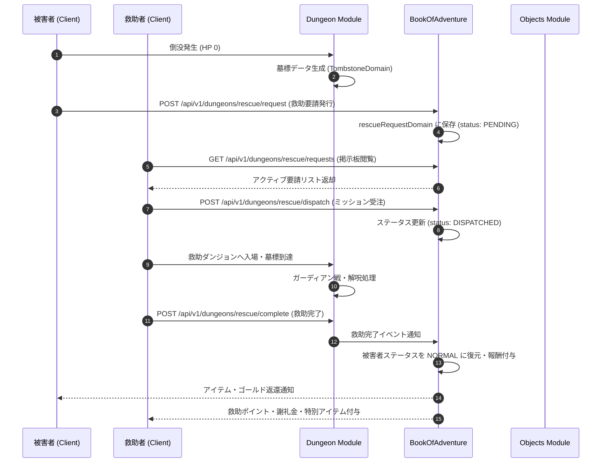

# ダンジョン救助・墓標システム (Dungeon Rescue & Tombstone System)

## 1. 概要
本ドキュメントは、プレイヤーがダンジョン探索中に倒没（HPが0）した際に発生する「墓標生成」「救助要請」および、他のプレイヤーが派遣されて墓標を解放・救助を行う「ダンジョン救助・墓標システム（Dungeon Rescue & Tombstone System）」の仕様を定義します。

本システムは、RogueB のマルチプレイヤー連携・非同期相互作用の中核を担い、従来の「倒没による即時全ロス」に救助の選択肢を提供すると同時に、救助者（レスキュアー）に名誉・名声・専用報酬を与える非同期協力エコシステムを構築します。

---

## 2. 墓標生成と倒没メカニズム (Tombstone Generation & Collapse Rules)

### 2.1 倒没（HP 0）時の処理フロー
1. **倒没判定**: プレイヤーの HP が 0 に到達した際、即時ロストを保留し「救助要請（Request Rescue）」を選択可能。
2. **墓標オブジェクト生成**: プレイヤーが倒没したダンジョン・階層・座標（`x, y`）に「プレイヤーの墓標（`Tombstone`）」エンティティを生成。
   - 墓標には倒没時に所持していたアイテム（Bag内）およびゴールドの 80% が封印・保持されます（残り 20% はペナルティとして消失）。
3. **セーブデータの一時ロック**: 該当キャラクターは「救助待ち（`AWAITING_RESCUE`）」状態となり、同一ダンジョンへの自力再挑戦は制限されます（ただし「救助断念（Give Up）」を選択することで通常ペナルティを受け入れて即時復帰可能）。

### 2.2 墓標（`TombstoneDomain`）の仕様
- **可視性**: 救助ミッションを受注したプレイヤー（救助者）のみ、該当フロアに到達した際にマップ上に特別な墓標アイコンとして表示。
- **守護霊（ガーディアン）戦**: 救助者が墓標タイルに接触・到達した際、墓標を守護する強敵モンスター「ガーディアン・スピリット（`Guardian Spirit`）」またはモンスターハウスが発生。これを撃破することで墓標が解呪（解放）されます。

---

## 3. 救助要請と受注フロー (Rescue Request & Mission Dispatch)

### 3.1 救助要請の発行 (`POST /api/v1/dungeons/rescue/request`)
- 倒没プレイヤーは、救助依頼文（メッセージ）、公開範囲（全体公開 / フレンド限定 / ワールド共有）、および救助謝礼金（任意追加ゴールド）を設定して要請を発行。
- 救助依頼データは `BookOfAdventure` モジュールの `rescueRequestDomain` に永続化。

### 3.2 救助掲示板とミッション受注 (`POST /api/v1/dungeons/rescue/dispatch`)
- 他のプレイヤーは町（拠点）の「救助掲示板」または UI 画面から、アクティブな救助要請一覧（`GET /api/v1/dungeons/rescue/requests`）を閲覧可能。
- 受注者は「救助用スクロール（`rescue_scroll`）」または専用の救助出撃枠を消費して、倒没プレイヤーのダンジョン・該当フロアへ特別出撃（レスキュー派遣）。

### 3.3 救助成功と報酬還元 (`POST /api/v1/dungeons/rescue/complete`)
- 救助者が対象階層でガーディアンを討伐し、墓標を調べると「救助成功（Rescue Complete）」通知を発行。
- **倒没プレイヤーへの返還**: 封印されていたアイテムおよびゴールドが次回ログイン/拠点復帰時に郵便箱・インベントリに返還。
- **救助者への報酬**: 救助ポイント（`Rescue Points`）、名声経験値、謝礼金、および特別限定アイテム「感謝の印（`token_of_gratitude`）」を獲得。

---

## 4. ドメインモデルおよびMongoDB永続化仕様 (Domain Models & MongoDB Persistence)

### 4.1 ドメインモデル構造

#### `TombstoneDomain` (Dungeon モジュール)
```java
public record TombstoneDomain(
    String tombstoneId,
    String dungeonId,
    int floorLevel,
    int x,
    int y,
    String victimUserId,
    String victimUserName,
    List<ThingInstance> sealedItems,
    int sealedGold,
    String guardianMonsterTypeId,
    boolean isUnlocked,
    LocalDateTime createdAt
) {}
```

#### `RescueRequestDomain` (BookOfAdventure モジュール)
```java
public record RescueRequestDomain(
    String requestId,
    String tombstoneId,
    String victimUserId,
    String victimUserName,
    String dungeonId,
    int floorLevel,
    String message,
    String visibility, // PUBLIC, FRIEND_ONLY, WORLD_TRUST
    String status,     // PENDING, DISPATCHED, COMPLETED, EXPIRED, CANCELLED
    String rescuerUserId,
    int rewardGoldBonus,
    LocalDateTime createdAt,
    LocalDateTime expiresAt
) {}
```

### 4.2 MongoDB 永続化仕様

#### 1) `playerTombstoneDomain` (Dungeon モジュール)
- **コレクション名**: `playerTombstoneDomain`
- **インデックス**:
  - `{"dungeonId": 1, "floorLevel": 1}` (複合)
  - `{"victimUserId": 1}` (ユニーク)

#### 2) `rescueRequestDomain` (BookOfAdventure モジュール)
- **コレクション名**: `rescueRequestDomain`
- **インデックス**:
  - `{"status": 1, "createdAt": -1}` (検索用複合)
  - `{"victimUserId": 1}`
  - `{"rescuerUserId": 1}`

---

## 5. モジュール間連携とシーケンスフロー (Inter-Module Data Flow)



---

## 6. API仕様 (API Specifications)

### 6.1 救助要請発行 (`POST /api/v1/dungeons/rescue/request`)
倒没時に墓標を作成し、救助掲示板に依頼を出信します。

#### リクエスト JSON スキーマ
```json
{
  "userId": "user_victim_001",
  "dungeonId": "dungeon_ancient_ruins",
  "floorLevel": 15,
  "coordinate": { "x": 12, "y": 8 },
  "message": "15階の深部で倒れました！どなたか助けてください！",
  "visibility": "PUBLIC",
  "rewardGoldBonus": 1000
}
```

#### レスポンス JSON スキーマ (200 OK)
```json
{
  "requestId": "res_req_99823",
  "tombstoneId": "tomb_88123",
  "status": "PENDING",
  "expiresAt": "2026-04-03T12:00:00Z",
  "message": "救助要請を正常に発行しました。他のプレイヤーの到着をお待ちください。"
}
```

---

### 6.2 救助要請一覧照会 (`GET /api/v1/dungeons/rescue/requests`)
救助掲示板で現在受注可能な救助依頼リストを取得します。

#### レスポンス JSON スキーマ (200 OK)
```json
{
  "requests": [
    {
      "requestId": "res_req_99823",
      "victimUserId": "user_victim_001",
      "victimUserName": "アリス",
      "dungeonId": "dungeon_ancient_ruins",
      "floorLevel": 15,
      "message": "15階の深部で倒れました！どなたか助けてください！",
      "rewardGoldBonus": 1000,
      "createdAt": "2026-03-31T10:00:00Z",
      "expiresAt": "2026-04-03T12:00:00Z"
    }
  ],
  "totalActiveRequests": 1
}
```

---

### 6.3 救助ミッション受注・出撃 (`POST /api/v1/dungeons/rescue/dispatch`)
対象の救助依頼を受注し、レスキュー出撃を開始します。

#### リクエスト JSON スキーマ
```json
{
  "rescuerUserId": "user_rescuer_002",
  "requestId": "res_req_99823",
  "rescueScrollInstanceId": "obj_inst_rescue_scroll_01"
}
```

#### レスポンス JSON スキーマ (200 OK)
```json
{
  "dispatchId": "disp_77123",
  "requestId": "res_req_99823",
  "targetDungeonId": "dungeon_ancient_ruins",
  "targetFloorLevel": 15,
  "status": "DISPATCHED",
  "message": "救助ミッションを開始しました。該当階層の墓標を目指してください。"
}
```

---

### 6.4 救助完了処理 (`POST /api/v1/dungeons/rescue/complete`)
墓標タイルでガーディアンを討伐し、解呪を完了した際に呼び出します。

#### リクエスト JSON スキーマ
```json
{
  "rescuerUserId": "user_rescuer_002",
  "requestId": "res_req_99823",
  "tombstoneId": "tomb_88123"
}
```

#### レスポンス JSON スキーマ (200 OK)
```json
{
  "status": "SUCCESS",
  "requestId": "res_req_99823",
  "rescuedVictimUserName": "アリス",
  "earnedRescuePoints": 150,
  "earnedRewardGold": 2500,
  "grantedItems": [
    {
      "instanceId": "obj_inst_token_99",
      "typeId": "token_of_gratitude",
      "name": "感謝の印"
    }
  ],
  "message": "救助成功！アリスの墓標を解放し、リソースを返還しました。"
}
```

---

## 7. エラーハンドリング仕様 (Error Handling Specification)

### 7.1 エラーコード一覧およびマッピング

| エラーコード | HTTPステータス | 発生条件・説明 |
| :--- | :---: | :--- |
| `RESCUE_REQUEST_NOT_FOUND` | `404 Not Found` | 指定された `requestId` が存在しない場合。 |
| `TOMBSTONE_NOT_FOUND` | `404 Not Found` | 指定された `tombstoneId` が存在しない場合。 |
| `ALREADY_RESCUED` | `409 Conflict` | 既に対象の救助依頼が完了している場合。 |
| `RESCUE_EXPIRED` | `400 Bad Request` | 救助依頼の有効期限が切れている場合。 |
| `CANNOT_RESCUE_SELF` | `400 Bad Request` | 自身の倒没に対する救助依頼を受注しようとした場合。 |
| `RESCUE_DISPATCH_LIMIT` | `400 Bad Request` | 同時に受注可能な救助ミッション数上限を超えている場合。 |
| `INSUFFICIENT_RESCUE_ITEM` | `400 Bad Request` | 出撃に必要な「救助用スクロール」等のアイテムが不足している場合。 |
| `GUARDIAN_NOT_DEFEATED` | `400 Bad Request` | 墓標のガーディアンがまだ撃破されていない状態で解呪を行おうとした場合。 |
