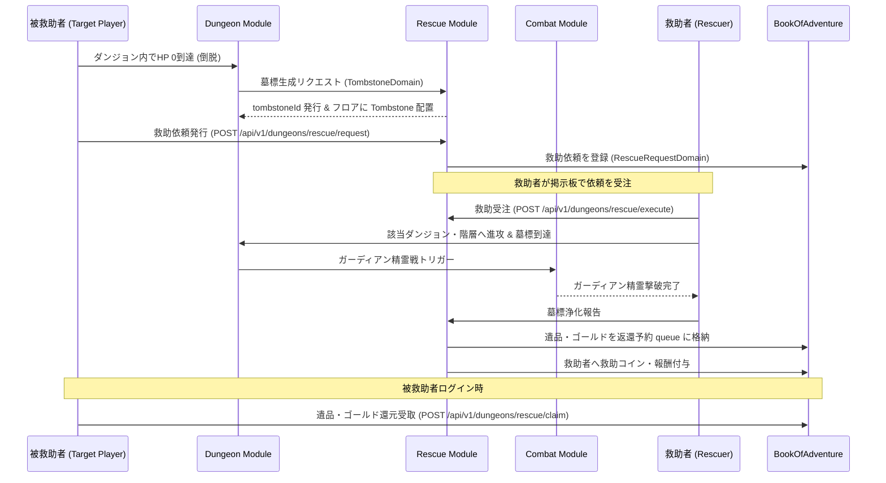

# ダンジョン救助・墓標システム (Dungeon Rescue & Tombstone System)

## 1. 概要
本ドキュメントは、ダンジョン探索中にプレイヤーがHP 0となり倒脱（コラプス）した際に発生する「墓標 (Tombstone)」の生成、救助依頼（Rescue Request）の発行、他プレイヤーまたは救助隊による救援ミッション、および遺品・ゴールドの回収・還元メカニズムの仕様を定義します。

このシステムにより、過酷なローグライク環境におけるデスペナルティの救済策、ソーシャル性、非同期マルチプレイ体験、ならびに他者を救う協力型エンドコンテンツを提供します。

---

## 2. コアメカニズム

### 2.1 倒脱（コラプス）と墓標の生成
1. **倒脱発生**: プレイヤーがダンジョン内でHP 0になると、通常の [死亡ペナルティ適用処理](./domain_models/Dungeon.md#44-死亡ペナルティ適用処理-post-apiv1dungeonsdungeoniddeath-penalty) に先立ち、プレイヤーが倒れた階層・座標に「墓標 (`Tombstone`)」オブジェクトが生成されます。
2. **墓標データ**: 墓標には、倒脱したプレイヤーID、没収されたアイテム・ゴールドの一覧、死亡時の階層・座標、および保護ガーディアン精霊の情報が保持されます。
3. **有効期限**: 墓標および救助依頼は、生成から **リアルタイム 72 時間** 有効です。期限が切れた場合、遺品は完全に消滅し、一般の没収ペナルティが確定します。

### 2.2 救助依頼の発行（Rescue Request）
1. **救助選択**: 倒脱時、プレイヤーは「自力退還（通常死亡ペナルティ受容）」または「救助依頼発行（SOS発信）」を選択できます。
2. **依頼タイプ**:
   - **パブリック依頼**: 全プレイヤーの救助掲示板（ギルド）に公開され、有志の他プレイヤーが受注します。
   - **フレンド/ギルド限定依頼**: 指定されたフレンドまたはギルドメンバーのみに限定して公開します。
   - **救助隊派遣（NPC/モンスター遠征）**: 他プレイヤーの支援を待たず、ゴールドや専用アイテム（`rescue_scroll`）を消費してNPC救助隊または手持ち控えモンスター遠征隊を派遣します。

### 2.3 救助ミッションの実行とガーディアン精霊戦
1. **受注とダンジョン潜入**: 救助者（Rescuer）は救助依頼を受注し、対象のダンジョン・階層へ到達を目指します。
2. **墓標の発見とガーディアン戦**: 救助者が対象フロアの墓標タイルに移動すると、「墓標の浄化（ガーディアン戦）」が発生します。
   - **ガーディアン精霊 (Guardian Spirit)**: 倒脱したプレイヤーの残滓から生じた霊体モンスター。倒脱したプレイヤーのレベルおよび所持品価値に応じたステータスを持ちます。
3. **浄化完了**: ガーディアン精霊を撃破する、または専用アイテム「供養の香 (`offering_incense`)」を使用することで墓標が浄化・開錠されます。

### 2.4 回収と還元フロー
1. **遺品の保管と転送**: 墓標の浄化に成功すると、保管されていた遺品・ゴールドはシステムの一時保管領域（Outbox / Rescue Mail）へ転送されます。
2. **被救助者への還元**: 被救助者（倒脱プレイヤー）が次回ログインまたは拠点画面を開いた際、没収されていたアイテムとゴールドが全額（または救助達成率に応じた90〜100%）返還されます。
3. **救助者への報酬**: 救助者には、感謝の報酬として「救助コイン (Rescue Coin)」、名声値、および経験値が与えられます。救助コインは専用ショップで貴重な錬金素材や限定装備と交換可能です。

---

## 3. ドメインモデル仕様

### 3.1 `TombstoneDomain` (墓標オブジェクト)
ダンジョンフロア上に存在する墓標エンティティを表します。

| プロパティ名 | 型 | 説明 |
| :--- | :--- | :--- |
| `tombstoneId` | `String` | 墓標の一意な識別子。 |
| `dungeonId` | `String` | 発生したダンジョンのID。 |
| `floorLevel` | `Integer` | 発生した階層（レベル）。 |
| `position` | `Coordinate` | 墓標が位置する2D/3D座標 (`x`, `y`, `z`)。 |
| `ownerUserId` | `String` | 倒脱したプレイヤーのユーザーID。 |
| `ownerPlayerName` | `String` | 倒脱したプレイヤーの表示名。 |
| `forfeitedItems` | `List<ThingInstanceDomain>` | 墓標内に保護されている没収アイテムリスト。 |
| `forfeitedGold` | `Long` | 墓標内に保護されている没収ゴールド量。 |
| `guardianMonsterTypeId` | `String` | 墓標を守るガーディアン精霊のモンスター種族ID。 |
| `status` | `TombstoneStatus` | 状態 (`ACTIVE`, `IN_PROGRESS`, `PURIFIED`, `EXPIRED`)。 |
| `createdAt` | `LocalDateTime` | 墓標生成日時。 |
| `expiresAt` | `LocalDateTime` | 墓標消失・救助期限日時（生成から72時間）。 |

### 3.2 `RescueRequestDomain` (救助依頼データ)
プレイヤー間でやり取りされる救助リクエストのデータを保持します。

| プロパティ名 | 型 | 説明 |
| :--- | :--- | :--- |
| `requestId` | `String` | 救助依頼の一意な識別子。 |
| `tombstoneId` | `String` | 紐づく墓標のID。 |
| `targetUserId` | `String` | 救援を求めているプレイヤーのユーザーID。 |
| `rescuerUserId` | `String` | 救助を担当しているプレイヤーのユーザーID（未受注時はnull）。 |
| `requestType` | `RescueRequestType` | 依頼種別 (`PUBLIC`, `FRIEND_ONLY`, `GUILD_ONLY`, `NPC_DISPATCH`)。 |
| `rewardCoins` | `Integer` | 救助成功時に救助者に与えられる救助コイン量。 |
| `status` | `RescueStatus` | 救助進捗状態 (`PENDING`, `ACCEPTED`, `COMPLETED`, `FAILED`, `EXPIRED`)。 |
| `createdAt` | `LocalDateTime` | 依頼作成日時。 |

---

## 4. モジュール間連携シーケンス



---

## 5. REST API仕様

### 5.1 救助依頼発行 (`POST /api/v1/dungeons/rescue/request`)
倒脱したプレイヤーが救助依頼を掲示板へ発行します。

#### リクエスト Payload 例
```json
{
  "tombstoneId": "tomb_887123_fl5",
  "userId": "user_target_999",
  "requestType": "PUBLIC",
  "message": "深淵の魔宮5階で倒れました！どなたか助けてください！"
}
```

#### レスポンス Payload 例 (200 OK)
```json
{
  "success": true,
  "requestId": "req_rescue_00192",
  "tombstoneId": "tomb_887123_fl5",
  "status": "PENDING",
  "expiresAt": "2026-04-03T12:00:00Z",
  "message": "救助依頼がパブリック掲示板に送信されました。"
}
```

---

### 5.2 アクティブ救助依頼一覧取得 (`GET /api/v1/dungeons/rescue/active`)
救助者が受注可能な救助依頼の一覧を取得します。

#### リクエストパラメータ例
`GET /api/v1/dungeons/rescue/active?dungeonId=dungeon_abyss_01&page=1&limit=10`

#### レスポンス Payload 例 (200 OK)
```json
{
  "total": 1,
  "requests": [
    {
      "requestId": "req_rescue_00192",
      "tombstoneId": "tomb_887123_fl5",
      "targetUserId": "user_target_999",
      "targetPlayerName": "Artemis",
      "dungeonId": "dungeon_abyss_01",
      "dungeonName": "深淵の魔宮",
      "floorLevel": 5,
      "forfeitedItemCount": 4,
      "forfeitedGold": 1200,
      "rewardCoins": 50,
      "createdAt": "2026-03-31T12:00:00Z"
    }
  ]
}
```

---

### 5.3 救助実行・墓標浄化 (`POST /api/v1/dungeons/rescue/execute`)
救助者が墓標タイルに到達し、ガーディアン精霊撃破後に浄化を実行します。

#### リクエスト Payload 例
```json
{
  "requestId": "req_rescue_00192",
  "rescuerUserId": "user_hero_777",
  "tombstoneId": "tomb_887123_fl5",
  "useOfferingIncense": false
}
```

#### レスポンス Payload 例 (200 OK)
```json
{
  "success": true,
  "requestId": "req_rescue_00192",
  "rescuerUserId": "user_hero_777",
  "status": "COMPLETED",
  "earnedRescueCoins": 50,
  "earnedExp": 350,
  "message": "墓標の浄化に成功し、被救助者の遺品を回収・転送しました。"
}
```

---

### 5.4 救助遺品・ゴールド受取 (`POST /api/v1/dungeons/rescue/claim`)
被救助者が救助完了した遺品とゴールドを受け取ります。

#### リクエスト Payload 例
```json
{
  "userId": "user_target_999",
  "requestId": "req_rescue_00192"
}
```

#### レスポンス Payload 例 (200 OK)
```json
{
  "success": true,
  "requestId": "req_rescue_00192",
  "recoveredGold": 1200,
  "recoveredItems": [
    {
      "instanceId": "item_inst_sword_9",
      "name": "鋼鉄の剣+3"
    }
  ],
  "message": "救助された遺品とゴールドを復元しました。"
}
```

---

## 6. 業務ルール・エラーハンドリング仕様

| エラーコード | HTTPステータス | 発生条件・詳細 |
| :--- | :---: | :--- |
| `RESCUE_REQUEST_NOT_FOUND` | 404 Not Found | 指定された救助依頼IDが存在しない場合。 |
| `TOMBSTONE_NOT_FOUND` | 404 Not Found | 指定された墓標IDがフロア上またはDB内に存在しない場合。 |
| `RESCUE_ALREADY_IN_PROGRESS` | 400 Bad Request | 該当の救助依頼が既に別の救助者によって進行中である場合。 |
| `RESCUE_EXPIRED` | 400 Bad Request | 72時間の期限が切れ、墓標および救助依頼が無効化されている場合。 |
| `UNAUTHORIZED_RESCUER` | 403 Forbidden | 非公開（フレンド/ギルド限定）の救助依頼に対して資格のないユーザーがアクセスした場合。 |
| `GUARDIAN_NOT_DEFEATED` | 400 Bad Request | ガーディアン精霊を撃破しておらず、供養の香も使用せずに浄化を実行しようとした場合。 |
| `INSUFFICIENT_RESCUE_ITEM` | 400 Bad Request | 救助隊派遣や特例浄化に必要な消費アイテム（`rescue_scroll`, `offering_incense` 等）を所持していない場合。 |
| `PLAYER_ALREADY_RESCUED` | 400 Bad Request | 既に救助完了・回収済みの依頼に対して受取処理を重複して実行した場合。 |
