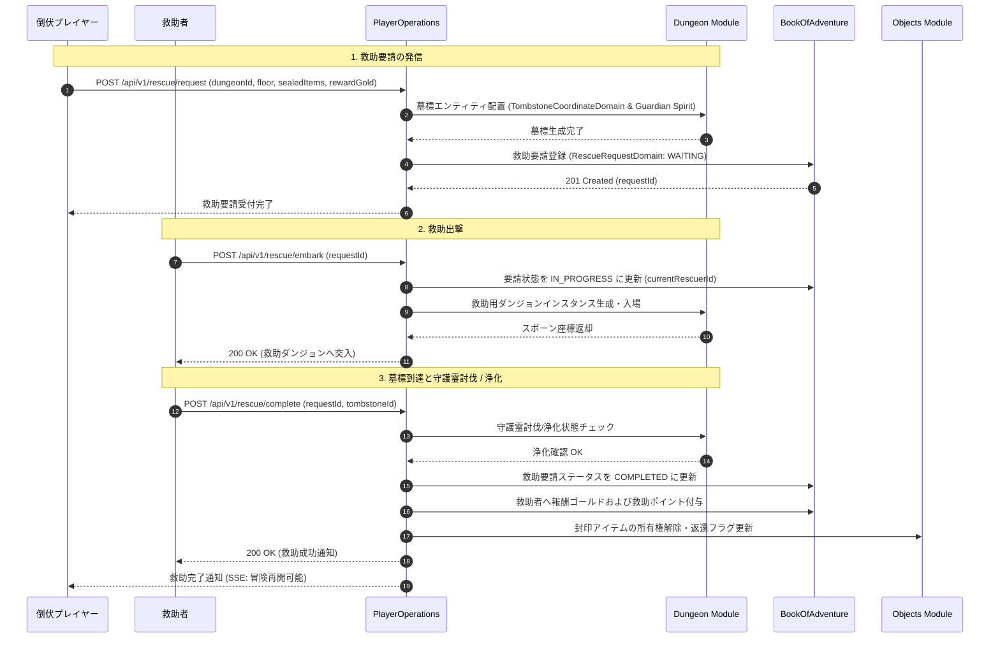

# ダンジョン救助・墓標システム (Dungeon Rescue & Tombstone System)

## 1. 概要
本ドキュメントは、ダンジョン内で倒れた（HP 0 になった）プレイヤーが、自らの遺留品やゴールドを保全するために他プレイヤーへ救助を求める「ダンジョン救助（Dungeon Rescue）」および、倒れた現場に生成される「墓標（Tombstone）」システムの仕様を定義します。

本システムは、過酷なデスペナルティのリスクを緩和する非同期マルチプレイ救済機能であり、救助を達成した救助者（レスキュー隊）に名誉と報酬を提供し、プレイヤー間の協力的なソーシャルインタラクションを活性化させます。

---

## 2. コアメカニズム (Core Mechanics)

### 2.1 プレイヤーの倒伏と選択肢
プレイヤーがダンジョン探索中に HP 0 となった際、即時の強制退出（デスペナルティ確定）か、「救助要請」の送信かを選択できます。

1. **諦めて帰還 (Surrender & Return)**:
   - ダンジョン管理者によって設定された [デスペナルティ](./Combat-System.md#4-デスペナルティの設定) を即時適用し、拠点（町）へリスポーンします。
2. **救助要請の発信 (Send Rescue Request)**:
   - 所持品（インベントリ）およびゴールドの一部または全部を、倒れたフロア座標の「墓標（Tombstone）」に封印します。
   - 救助掲示板（Rescue Board）に救助要請（`RescueRequest`）が登録され、プレイヤーは拠点で待機状態（または他キャラクター/別ダンジョンでのプレイ）となります。
   - 救助成功時、没収予定だったアイテム・ゴールドを回収して救助地点から冒険を再開できます。

### 2.2 墓標（Tombstone）エンティティ
- **生成ルール**:
  - プレイヤーが倒れた階層・座標に、特殊なオブジェクトエンティティ「墓標（`Tombstone`）」が生成されます。
  - 表示文字は `+` または `T`（灰色/石色）。
- **封印内容**:
  - 倒れたプレイヤーのインベントリアイテムインスタンス ID リスト。
  - 倒れたプレイヤーの所持ゴールド。
  - 倒れた原因（撃破モンスター種別、トラップID、環境異変等）。
- **墓標の守護霊（Guardian Spirit）**:
  - 墓標の周囲には、プレイヤーの無念と思念が結晶化した強力な中ボス級モンスター「守護霊（Guardian Spirit）」が配置されます。
  - 救助者が墓標にインタラクトまたは墓標の封印を解くためには、この守護霊を討伐するか、特殊アイテム「供養のお香（`offering_incense`）」を使用して浄化・成仏させる必要があります。

### 2.3 救助要請の期限と失敗時のフロー
- **救助期限**:
  - 救助要請の有効期限は、登録から **リアルタイム 48 時間**（またはゲーム内日数）です。
  - 救助出撃は最大 **3 回**（3 人の異なる救助者）まで挑戦可能です。
- **救助失敗・期限切れ時の処理**:
  - 3 回すべての救助が失敗するか、有効期限が切れた場合、要請は「失効 (`EXPIRED`)」となります。
  - 封印されていたアイテムおよびゴールドは、通常のデスペナルティ設定に基づき**ダンジョン管理者へ没収・帰属**されます。

### 2.4 救助者のインセンティブと報酬
救助を成功させたプレイヤーには、以下の報酬が与えられます。

1. **救助ポイント（Rescue Points）**:
   - 拠点の救助所（レスキューギルド）で、希少な触媒、特性オーブ、限定称号と交換可能。
2. **謝礼金（Rescue Fee）**:
   - 救助要請者が事前に設定した謝礼ゴールド（最低額: 500 G、または遺留ゴールドの 20%）。
3. **名誉実績・称号**:
   - 「救助者」「慈愛の探検家」「魂の解放者」等の実績進捗および称号解禁。詳細は [プレイヤー称号・実績システム](./Player-Title-Achievement-System.md) を参照。

---

## 3. ドメインモデル構造 (Domain Models)

### 3.1 `RescueRequestDomain` (BookOfAdventure モジュール)
```java
public record RescueRequestDomain(
    String requestId,
    String targetUserId,
    String targetUserName,
    String dungeonId,
    String dungeonName,
    int floorLevel,
    Coordinate2D deathCoordinate,
    String causeOfDeath,
    List<String> sealedItemInstanceIds,
    int sealedGold,
    int rewardGold,
    int rescueAttemptsLeft,
    RescueStatus status,
    String currentRescuerId,
    LocalDateTime createdAt,
    LocalDateTime expiresAt,
    LocalDateTime completedAt
) {}

public enum RescueStatus {
    WAITING,       // 救助待機中
    IN_PROGRESS,   // 救助者がダンジョン攻略中
    COMPLETED,     // 救助成功・完了
    EXPIRED,       // 期限切れ
    FAILED         // 規定回数失敗による終了
}
```

### 3.2 `TombstoneCoordinateDomain` (Dungeon モジュール)
```java
public record TombstoneCoordinateDomain(
    String tombstoneId,
    Coordinate position,
    String targetUserId,
    String targetUserName,
    String rescueRequestId,
    boolean isGuardianDefeated,
    boolean isPurified,
    LocalDateTime createdAt
) {}
```

---

## 4. モジュール間連携とシーケンスフロー (Sequence Diagram)



---

## 5. API仕様 (API Specifications)

### 5.1 救助要請作成 (`POST /api/v1/rescue/request`)
プレイヤーがダンジョン内で倒れた際、墓標を生成して救助掲示板へ要請を発信します。

#### リクエスト JSON スキーマ
```json
{
  "userId": "user_victim_12345",
  "dungeonId": "dungeon_abyss_01",
  "floorLevel": 7,
  "deathCoordinate": { "x": 14, "y": 9 },
  "causeOfDeath": "MONSTER_HIGH_DEMON",
  "rewardGold": 1500
}
```

#### レスポンス JSON スキーマ (201 Created)
```json
{
  "requestId": "res_req_887123",
  "status": "WAITING",
  "tombstoneId": "tomb_dungeon_abyss_01_7_14_9",
  "sealedItemsCount": 8,
  "sealedGold": 3200,
  "rewardGold": 1500,
  "rescueAttemptsLeft": 3,
  "expiresAt": "2026-04-02T12:00:00Z"
}
```

---

### 5.2 救助要請一覧照会 (`GET /api/v1/rescue/requests`)
救助掲示板に登録されている未解決の救助要請一覧を取得します。

#### クエリパラメータ
- `status`: `WAITING`, `IN_PROGRESS` (省略時は `WAITING`)
- `dungeonId`: 特定ダンジョンによる絞り込み（任意）

#### レスポンス JSON スキーマ (200 OK)
```json
{
  "total": 1,
  "requests": [
    {
      "requestId": "res_req_887123",
      "targetUserId": "user_victim_12345",
      "targetUserName": "探検家アレン",
      "dungeonId": "dungeon_abyss_01",
      "dungeonName": "深淵の魔宮",
      "floorLevel": 7,
      "causeOfDeath": "MONSTER_HIGH_DEMON",
      "rewardGold": 1500,
      "rescueAttemptsLeft": 3,
      "createdAt": "2026-03-31T12:00:00Z",
      "expiresAt": "2026-04-02T12:00:00Z"
    }
  ]
}
```

---

### 5.3 救助出撃 (`POST /api/v1/rescue/embark`)
救助者が特定の救助要請を引き受け、救助専用ダンジョンへ入場します。

#### リクエスト JSON スキーマ
```json
{
  "userId": "user_rescuer_9988",
  "requestId": "res_req_887123"
}
```

#### レスポンス JSON スキーマ (200 OK)
```json
{
  "status": "SUCCESS",
  "requestId": "res_req_887123",
  "dungeonId": "dungeon_abyss_01",
  "targetFloor": 7,
  "spawnCoordinate": { "x": 3, "y": 4, "z": 0 },
  "message": "深淵の魔宮 7F に眠る「探検家アレン」の救助任務を開始しました。"
}
```

---

### 5.4 救助達成・墓標解放 (`POST /api/v1/rescue/complete`)
墓標の守護霊を討伐または浄化し、救助任務を完了します。

#### リクエスト JSON スキーマ
```json
{
  "userId": "user_rescuer_9988",
  "requestId": "res_req_887123",
  "tombstoneId": "tomb_dungeon_abyss_01_7_14_9",
  "useIncenseItemInstanceId": "obj_inst_incense_01"
}
```

#### レスポンス JSON スキーマ (200 OK)
```json
{
  "status": "SUCCESS",
  "requestId": "res_req_887123",
  "rewardGoldEarned": 1500,
  "rescuePointsEarned": 100,
  "message": "墓標の封印を解き、救助任務を完了しました！謝礼金と救助ポイントが付与されました。"
}
```

---

## 6. エラーハンドリング仕様 (Error Handling Specification)

### 6.1 エラーレスポンス共通 JSON スキーマ
```json
{
  "errorCode": "RESCUE_ALREADY_UNDERWAY",
  "message": "この救助要請はすでに別のプレイヤーが出撃中です。",
  "timestamp": "2026-03-31T12:00:00Z"
}
```

### 6.2 エラーコード一覧およびマッピング

| エラーコード | HTTPステータス | 発生条件・説明 |
| :--- | :---: | :--- |
| `REQUEST_NOT_FOUND` | `404 Not Found` | 指定された `requestId` の救助要請が存在しない場合。 |
| `TOMBSTONE_NOT_FOUND` | `404 Not Found` | 指定された `tombstoneId` の墓標が対象フロアに存在しない場合。 |
| `CANNOT_RESCUE_SELF` | `400 Bad Request` | 自分自身の救助要請に出撃しようとした場合。 |
| `RESCUE_ALREADY_UNDERWAY` | `409 Conflict` | 対象の救助要請が既に他のプレイヤーによって出撃中（`IN_PROGRESS`）である場合。 |
| `RESCUE_EXPIRED` | `400 Bad Request` | 救助要請の有効期限（48時間）が切れている場合。 |
| `NO_ATTEMPTS_LEFT` | `400 Bad Request` | 規定の出撃失敗回数（最大3回）を超過している場合。 |
| `GUARDIAN_NOT_DEFEATED` | `400 Bad Request` | 墓標の守護霊が討伐されておらず、浄化アイテムも指定されていない場合。 |
| `INVALID_INCENSE_ITEM` | `400 Bad Request` | 墓標の浄化に使用できない無効なアイテムが指定された場合。 |
| `INSUFFICIENT_REWARD_GOLD` | `400 Bad Request` | 救助要請作成時、謝礼金として指定したゴールドが不足している場合。 |
| `UNAUTHORIZED_RESCUER` | `403 Forbidden` | 出撃を引き受けていないプレイヤーが救助完了を試みた場合。 |
