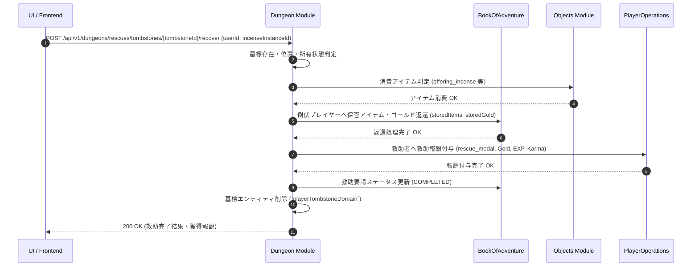

# ダンジョン救助・墓標システム (Dungeon Rescue & Tombstone System)

## 1. 概要
本ドキュメントは、プレイヤーがダンジョン探索中に HP が 0 となり倒伏（全滅）した際に、その倒伏地点に所持アイテムやゴールドを保管する「墓標（Tombstone）」を生成し、他のプレイヤーまたは救助派遣隊がその階層へ潜入して墓標を回収・救助を行う「ダンジョン救助・墓標システム（Dungeon Rescue & Tombstone System）」の仕様を定義します。

本システムは RogueB の「ダンジョン探索・経済・ソーシャル連携」を横断し、デスペナルティの救済手段、救助プレイヤーに対する報酬・名声（カルマ）インセンティブ、および他プレイヤーとの非同期協力プレイ体験を提供します。

---

## 2. 救助・墓標メカニズム (Rescue & Tombstone Mechanics)

### 2.1 倒伏と墓標生成
1. **倒伏判定と墓標ドロップ**:
   - プレイヤーの HP が 0 になった際、即座に全所持アイテム・ゴールドを消失させる代わりに、倒伏した座標タイルに「墓標エンティティ（`TombstoneDomain`）」が生成されます。
   - 倒伏時のインベントリ内のアイテム（装備・消費財等）およびゴールドの一定割合（デフォルト: 80%）が墓標内部の保護ストレージへ一時封入されます。
2. **救助要請（Rescue Request）の発行**:
   - 倒伏後、プレイヤーは「自力脱出（ペナルティ確定帰還）」または「救助要請（Rescue Request）」のいずれかを選択します。
   - 救助要請を選択した場合、`BookOfAdventure` モジュールを介して救助掲示板に `RescueRequestDomain` が登録され、他プレイヤーからの検索・受諾が可能になります。
   - 救助要請には有効期限（例: 72時間）が設定されます。

### 2.2 救助要請掲示板と受付
1. **救助掲示板 (Rescue Board)**:
   - 各プレイヤーは拠点（町）または「救助の巻物（`rescue_scroll`）」を介して、現在募集中の救助要請一覧を照会できます。
   - 救助要請には、対象ダンジョン名、倒伏階層、倒伏プレイヤー名、墓標ランク、および成功時の獲得予測報酬が表示されます。
2. **救助の受諾 (Rescue Acceptance)**:
   - 1 つの救助要請につき、同時に受諾できる救助者は 1 人（または 1 パーティ）のみです。
   - 受諾した救助者には、該当ダンジョンの倒伏階層へ直接転移可能な「救助用ポータル」または専用セッションの進入権限が付与されます。

### 2.3 救助探索セッションと回収・解放
1. **救助潜入と守護霊・罠**:
   - 救助者が対象の階層に到達すると、墓標タイルの周囲に倒伏時のモンスター群や「墓標の守護霊（Guardian Spirit）」が配置されます。
2. **墓標回収インタラクション**:
   - 救助者が墓標タイルに到達し、「供養の線香（`offering_incense`）」または「墓標の鍵（`tombstone_key`）」を使用するかインタラクションを行うことで、墓標の封印が解除（回収完了）されます。
   - 墓標回収が成功すると、即座に救助完了イベントが発行されます。
3. **アイテム還元と救助完了**:
   - 回収された墓標内のアイテムおよびゴールドは、元の倒伏プレイヤーの郵便箱/受け取りストレージへ全額（または回収手数料を引いた額）返還されます。

### 2.4 救助報酬・名声（カルマ）・ペナルティ軽減
- **救助者への報酬**:
  - 救助成功時、救助者には「救助メダル（`rescue_medal`）」、ゴールド、大量のプレイヤー経験値、および名声値（Karma）が付与されます。
  - 救助メダルは、救助専用ショップにて限定装備・貴重な強化触媒・高階級レシピ等と交換可能です。
- **倒伏者へのメリット**:
  - デスペナルティ（装備消失・ゴールド全額損失）を大幅に回避でき、失われた貴重なアイテムを100%回収できます。

---

## 3. 救助関連アイテム・消費財 (Rescue Items)

本システムを補助・拡張するために以下のアイテムが利用されます（`Objects` モジュールへ登録）。

| アイテム ID (`typeId`) | 名称 | カテゴリ | 説明・効果 | 標準価格 |
| :--- | :--- | :--- | :--- | :---: |
| `rescue_scroll` | 救助の巻物 | Consumable | 使用すると即座に救助掲示板を開き、現在アクティブな救助要請を受諾可能。 | 500 Gold |
| `offering_incense` | 供養の線香 | Consumable | 墓標回収時に使用。周囲の怨念・守護霊を浄化し、無戦闘で安全に墓標を解放。 | 800 Gold |
| `tombstone_key` | 墓標の鍵 | Special | 鍵のかかった特殊な高難易度墓標（Sランクダンジョン等）を解錠するための万能鍵。 | 1,500 Gold |
| `rescue_medal` | 救助メダル | Special | 救助成功時に進呈される特別な硬貨。救助専用交換所で貴重品と交換可能。 | - (非売品) |

---

## 4. ドメインモデルおよびMongoDB永続化仕様 (Domain Models & MongoDB Persistence)

### 4.1 ドメインモデル構造

#### `TombstoneDomain` (ダンジョン内墓標エンティティ)
```java
public record TombstoneDomain(
    String tombstoneId,
    String dungeonId,
    int floorLevel,
    Coordinate2D position,
    String ownerUserId,
    List<ThingInstance> storedItems,
    int storedGold,
    boolean isLocked,
    String requiredKeyTypeId,
    LocalDateTime createdAt
) {}
```

#### `RescueRequestDomain` (救助要請エンティティ)
```java
public record RescueRequestDomain(
    String requestId,
    String tombstoneId,
    String targetUserId,
    String targetUserName,
    String dungeonId,
    int floorLevel,
    String status, // PENDING, ACCEPTED, COMPLETED, EXPIRED, CANCELLED
    String acceptedByUserId,
    LocalDateTime createdAt,
    LocalDateTime expiresAt,
    LocalDateTime completedAt
) {}
```

---

### 4.2 MongoDB 永続化仕様

#### 1) `playerTombstoneDomain` (`Dungeon` モジュール)
- **コレクション名**: `playerTombstoneDomain`
- **目的**: 各ダンジョンフロア上に存在するアクティブな墓標データの保持。

```json
{
  "_id": "tombstone_uuid_001",
  "tombstoneId": "tombstone_uuid_001",
  "dungeonId": "dungeon_ancient_catacomb",
  "floorLevel": 5,
  "position": { "x": 12, "y": 8 },
  "ownerUserId": "user_victim_123",
  "storedItems": [
    {
      "instanceId": "item_sword_99",
      "typeId": "dragon_slayer_sword",
      "quantity": 1
    }
  ],
  "storedGold": 3500,
  "isLocked": false,
  "requiredKeyTypeId": null,
  "createdAt": "2026-03-31T10:00:00Z"
}
```

#### インデックス設計
| コレクション | インデックスキー | ユニーク | 目的・用途 |
| :--- | :--- | :---: | :--- |
| `playerTombstoneDomain` | `{"dungeonId": 1, "floorLevel": 1}` | No | フロア読み込み時の墓標一覧検索 |
| `playerTombstoneDomain` | `{"ownerUserId": 1}` | No | プレイヤー所有墓標の検索 |

---

#### 2) `rescueRequestDomain` (`BookOfAdventure` モジュール)
- **コレクション名**: `rescueRequestDomain`
- **目的**: 全世界の救助要請・掲示板状態の管理。

```json
{
  "_id": "rescue_req_888",
  "requestId": "rescue_req_888",
  "tombstoneId": "tombstone_uuid_001",
  "targetUserId": "user_victim_123",
  "targetUserName": "HeroBrave",
  "dungeonId": "dungeon_ancient_catacomb",
  "floorLevel": 5,
  "status": "ACCEPTED",
  "acceptedByUserId": "user_rescuer_456",
  "createdAt": "2026-03-31T10:05:00Z",
  "expiresAt": "2026-04-03T10:05:00Z",
  "completedAt": null
}
```

#### インデックス設計
| コレクション | インデックスキー | ユニーク | 目的・用途 |
| :--- | :--- | :---: | :--- |
| `rescueRequestDomain` | `{"status": 1, "createdAt": -1}` | No | 救助掲示板のアクティブ要請照会 |
| `rescueRequestDomain` | `{"targetUserId": 1}` | No | 倒伏プレイヤーの要請状況確認 |
| `rescueRequestDomain` | `{"acceptedByUserId": 1}` | No | 救助者の担当中要請確認 |

---

## 5. モジュール間連携とシーケンスフロー (Inter-Module Data Flow & Sequence Diagram)



---

## 6. API仕様 (API Specifications)

### 6.1 アクティブ救助要請一覧照会 (`GET /api/v1/dungeons/rescues/requests`)
救助掲示板で募集中（`PENDING`）の救助要請一覧を取得します。

#### リクエストパラメータ
- `dungeonId` (任意): ダンジョン ID フィルタ
- `page` (任意, default: 0): ページ番号
- `size` (任意, default: 20): 取得件数

#### レスポンス JSON スキーマ (200 OK)
```json
{
  "totalRequests": 1,
  "page": 0,
  "size": 20,
  "requests": [
    {
      "requestId": "rescue_req_888",
      "tombstoneId": "tombstone_uuid_001",
      "targetUserId": "user_victim_123",
      "targetUserName": "HeroBrave",
      "dungeonId": "dungeon_ancient_catacomb",
      "floorLevel": 5,
      "status": "PENDING",
      "rewardMedals": 3,
      "rewardGold": 1200,
      "expiresAt": "2026-04-03T10:05:00Z"
    }
  ]
}
```

---

### 6.2 救助要請受諾 (`POST /api/v1/dungeons/rescues/requests/{requestId}/accept`)
救助者が指定した救助要請を受諾し、担当権限を取得します。

#### リクエスト JSON スキーマ
```json
{
  "userId": "user_rescuer_456"
}
```

#### レスポンス JSON スキーマ (200 OK)
```json
{
  "status": "ACCEPTED",
  "requestId": "rescue_req_888",
  "tombstoneId": "tombstone_uuid_001",
  "dungeonId": "dungeon_ancient_catacomb",
  "targetFloorLevel": 5,
  "portalAccessKey": "portal_key_救助_55",
  "message": "救助要請を受諾しました。第 5 階層の墓標を目指してください。"
}
```

---

### 6.3 墓標回収・救助完了 (`POST /api/v1/dungeons/rescues/tombstones/{tombstoneId}/recover`)
墓標に到達した救助者が墓標を回収し、救助を完了させます。

#### リクエスト JSON スキーマ
```json
{
  "userId": "user_rescuer_456",
  "incenseInstanceId": "obj_inst_incense_01"
}
```

#### レスポンス JSON スキーマ (200 OK)
```json
{
  "status": "RESCUE_COMPLETED",
  "tombstoneId": "tombstone_uuid_001",
  "targetUserName": "HeroBrave",
  "recoveredItemCount": 8,
  "recoveredGold": 3500,
  "rewardsGained": {
    "rescueMedals": 3,
    "gold": 1200,
    "exp": 2500,
    "karmaBonus": 15
  },
  "message": "供養の線香により墓標を無事回収しました！倒伏プレイヤーへ遺品が返還されました。"
}
```

---

### 6.4 救助要請放棄・断念 (`POST /api/v1/dungeons/rescues/tombstones/{tombstoneId}/give-up`)
受諾中の救助要請を断念・キャンセルし、要請を未受諾状態（`PENDING`）へ戻します。

#### リクエスト JSON スキーマ
```json
{
  "userId": "user_rescuer_456",
  "reason": "ABANDONED"
}
```

#### レスポンス JSON スキーマ (200 OK)
```json
{
  "status": "PENDING",
  "requestId": "rescue_req_888",
  "message": "救助要請を辞退しました。要請は再度掲示板へ公開されました。"
}
```

---

## 7. エラーハンドリング仕様 (Error Handling Specification)

### 7.1 エラーレスポンス共通 JSON スキーマ
```json
{
  "errorCode": "RESCUE_REQUEST_NOT_FOUND",
  "message": "指定された救助要請が存在しないか、すでに期限切れです。",
  "timestamp": "2026-03-31T12:00:00Z"
}
```

### 7.2 エラーコード一覧およびマッピング

| エラーコード | HTTPステータス | 発生条件・説明 |
| :--- | :---: | :--- |
| `RESCUE_REQUEST_NOT_FOUND` | `404 Not Found` | 指定された `requestId` が存在しない場合。 |
| `TOMBSTONE_NOT_FOUND` | `404 Not Found` | 指定された `tombstoneId` がダンジョンフロア上に存在しない場合。 |
| `RESCUE_ALREADY_ACCEPTED` | `409 Conflict` | 救助要請が既に他のプレイヤーによって受諾されている場合。 |
| `CANNOT_RESCUE_SELF` | `400 Bad Request` | プレイヤーが自分の墓標に対する救助要請を受諾しようとした場合。 |
| `RESCUE_EXPIRED` | `410 Gone` | 救助要請の有効期限（72時間）が切れている場合。 |
| `TOMBSTONE_ALREADY_RECOVERED` | `409 Conflict` | 対象の墓標が既に回収済みである場合。 |
| `UNAUTHORIZED_RESCUER` | `403 Forbidden` | 救助要請を受諾していない第三者が墓標回収コマンドを実行した場合。 |
| `INSUFFICIENT_RESCUE_ITEM` | `400 Bad Request` | 墓標回収に必要な消費アイテム（供養の線香、墓標の鍵等）を所持していない場合。 |
| `DUNGEON_NOT_FOUND` | `404 Not Found` | 対象のダンジョン ID が存在しない場合。 |
| `BAG_FULL` | `400 Bad Request` | 返還時または報酬獲得時にインベントリに空きがない場合。 |
