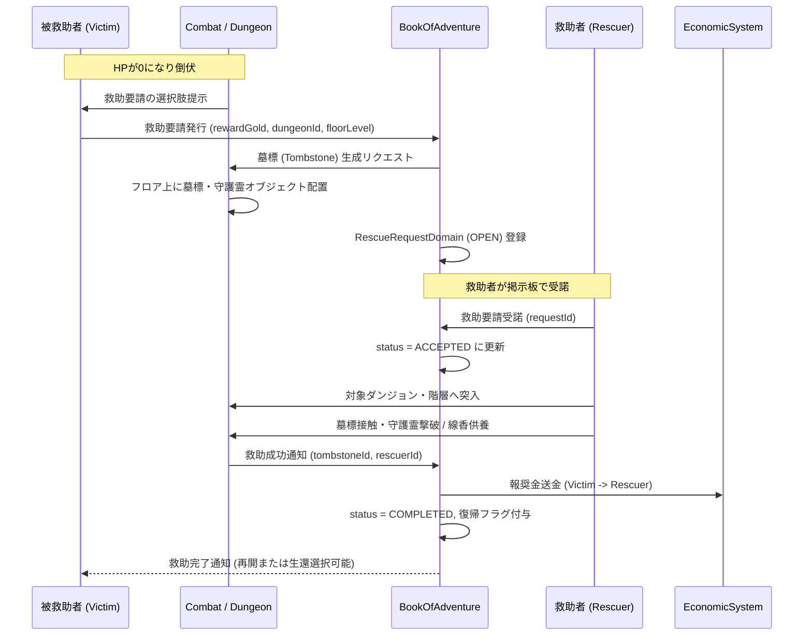

# ダンジョン救助・墓標システム仕様 (Dungeon Rescue & Tombstone System)

## 1. 概要
本ドキュメントは、ダンジョン探索中にプレイヤーがHP 0となり力尽きた際に、他のプレイヤーへの「救助要請（Rescue Request）」を発行し、死亡階層に生成される「墓標（Tombstone）」を巡って救助者が探索・挑戦を行う「ダンジョン救助・墓標システム」の仕様を定義します。

本システムにより、ローグライク特有の厳しいデスペナルティ（全ロスト等のリスク）を救助要請というソーシャル・非対称マルチプレイ要素によって緩和しつつ、救助者側には貴重な報酬・名誉称号・経済的インセンティブを提供する新たなプレイループを確立します。

---

## 2. コアコンセプトとシステムフロー

### 2.1 力尽きた際の選択肢
プレイヤーがダンジョン探索中にHP 0になった際、以下の2つの選択肢が提示されます。

1. **諦めて帰還（通常死亡）**:
   - ダンジョン管理者によって設定されたデスペナルティ（所持金・アイテムの没収、ステータスリセット等）が即時適用され、拠点へ強制送還されます。
2. **救助要請の発行（Rescue Request）**:
   - プレイヤーは現在のダンジョン・フロア・死亡座標に「墓標（Tombstone）」を設置し、サーバー全体へ救助掲示板（レスキューボード）を通じて救助要請を発行します。
   - 要請者の探索セッションは「待機状態（Rescue Pending）」となり、救助が成功した場合はロストしたアイテムやゴールドを回収してその階層から探索を再開できます。

### 2.2 墓標（Tombstone）と守護霊バトル
- 死亡地点のタイルには「墓標（`+` または石碑シンボル）」が生成されます。
- 墓標には倒伏時の遺品（アイテム・ゴールド）が封印されており、不用意な荒らしや不正回収を防ぐため、要請者のシャドウ（守護霊/幻影）がガーディアンとして守護しています。
- 救助者は該当フロアの墓標に到達し、守護霊との戦闘に勝利するか、特殊触媒アイテム「供養の線香（`offering_incense`）」を捧げることで墓標を解放（浄化）します。

### 2.3 救助成立と報酬
- **救助者（Rescue Player）への報酬**:
  - 要請者が設定した「救助報奨金（Rescue Bounty: 最低500 Gold 〜 所持金上限）」の獲得。
  - 救助ポイント（レスキュー評価値）の獲得（プレイヤー実績や限定称号の解禁条件）。
  - ダンジョンクリア時の追加ボーナス。
- **要請者（Downed Player）へのメリット**:
  - 所持品およびゴールドの喪失を回避（報奨金として支払った分を除く）。
  - 倒れた階層・座標からHP全快・無敵バフ（3ターン）付きで探索再開、または無傷で拠点へエスケープ帰還する選択が可能。

---

## 3. 主要なドメインオブジェクト

### 3.1 `TombstoneDomain` (ダンジョンモジュール内)
フロア上に物理的に配置される墓標オブジェクトです。
- **プロパティ:**
  - `tombstoneId`: 墓標の一意な識別子 (UUID)。
  - `dungeonId`: ダンジョン ID。
  - `floorLevel`: 発生階層。
  - `position`: 墓標が配置された座標 (`Coordinate`)。
  - `victimUserId`: 倒れたプレイヤーの ID。
  - `victimName`: 倒れたプレイヤー名。
  - `sealedItems`: 封印されている遺品アイテムのインスタンス ID リスト。
  - `sealedGold`: 封印されているゴールド量。
  - `guardianType`: 守護霊の種族/タイプ (`SHADOW_REPLICA`, `VENGEFUL_SPIRIT` 等)。
  - `guardianStats`: 守護霊の戦闘ステータス（HP, ATK, DEF 等）。
  - `isPurified`: 浄化・救助達成済みフラグ (boolean)。
  - `createdAt`: 墓標生成タイムスタンプ。
  - `expiresAt`: 救助要請の有効期限タイムスタンプ（通常は発行からリアルタイム 48 時間）。

### 3.2 `RescueRequestDomain` (BookOfAdventureモジュール内)
プレイヤー間の救助要請・マッチングを管理する掲示板エンティティです。
- **プロパティ:**
  - `requestId`: 救助要請の一意な識別子 (UUID)。
  - `tombstoneId`: 紐づく墓標の ID。
  - `victimUserId`: 要請者のユーザー ID。
  - `victimName`: 要請者のプレイヤー名。
  - `dungeonId`: 対象ダンジョン ID。
  - `floorLevel`: 救助対象階層。
  - `rewardGold`: 救助成功時に救助者へ支払われる報奨金。
  - `acceptedRescuerId`: 要請を受諾した救助者のユーザー ID（未受諾時は null）。
  - `status`: 要請状態 (Enum: `OPEN`, `ACCEPTED`, `COMPLETED`, `EXPIRED`, `CANCELLED`)。
  - `createdAt`: 要請日時。
  - `completedAt`: 救助完了日時。

---

## 4. 救助システムのルールと制限

### 4.1 救助回数制限
- 1回のダンジョン挑戦において、救助要請を発行できる回数は **最大 3 回** までです（ダンジョンランク S の独自ルール等で変更可能）。
- 3回目の救助要請が失敗または再死亡した場合、強制的に通常死亡ペナルティが適用されます。

### 4.2 守護霊（シャドウ）の仕様
- 墓標を調べる（アクションを実行する）と、要請者のレベル・装備ステータスをベースに複製された「守護霊（シャドウ）」との特殊戦闘が発生します。
- 守護霊は属性耐性（ゴースト属性/全状態異常無効）を持ち、要請者が習得していたスキルをランダムに使用します。
- 救助者が「供養の線香（`offering_incense`）」をインベントリに所持して使用した場合、守護霊バトルをスキップして即座に墓標を浄化できます。

### 4.3 救助期限とキャンセル
- 救助要請の発行から **48時間（リアルタイム）** が経過した場合、要請は `EXPIRED` となり、墓標は崩壊して遺品は通常のデスペナルティに則って処理されます。
- 要請者はいつでも救助掲示板から「自力帰還（要請の自主取り下げ）」を選択でき、その場合は通常のデスペナルティを受けて拠点へ戻ります。

---

## 5. モジュール間連携シーケンス



---

## 6. API仕様 (API Specifications)

### 6.1 救助要請発行 (`POST /api/v1/dungeons/rescue/request`)
倒伏したプレイヤーが救助要請を発行し、墓標を生成します。

#### リクエスト (Request)
```json
{
  "userId": "user_victim_01",
  "dungeonId": "dungeon_frontier_01",
  "floorLevel": 5,
  "rewardGold": 1000,
  "coordinate": {
    "x": 14,
    "y": 18,
    "z": 0
  }
}
```

#### レスポンス (Response: 201 Created)
```json
{
  "requestId": "res_req_881920",
  "tombstoneId": "tomb_992144",
  "victimUserId": "user_victim_01",
  "dungeonId": "dungeon_frontier_01",
  "floorLevel": 5,
  "rewardGold": 1000,
  "status": "OPEN",
  "expiresAt": "2026-04-02T12:00:00Z"
}
```

---

### 6.2 救助要請一覧照会 (`GET /api/v1/dungeons/rescue/requests`)
救助者が受諾可能な公開中の救助要請リストを取得します。

#### クエリパラメータ
- `dungeonId` (任意): 特定ダンジョンでフィルタ
- `status` (任意、デフォルト: `OPEN`): 要請ステータス

#### レスポンス (Response: 200 OK)
```json
{
  "requests": [
    {
      "requestId": "res_req_881920",
      "victimUserId": "user_victim_01",
      "victimName": "BraveAdventurer",
      "dungeonId": "dungeon_frontier_01",
      "dungeonName": "試練の洞窟",
      "floorLevel": 5,
      "rewardGold": 1000,
      "status": "OPEN",
      "createdAt": "2026-03-31T12:00:00Z",
      "expiresAt": "2026-04-02T12:00:00Z"
    }
  ]
}
```

---

### 6.3 救助要請受諾 (`POST /api/v1/dungeons/rescue/requests/{requestId}/accept`)
救助者が指定された救助要請を受諾し、救助権を獲得します。

#### リクエスト (Request)
```json
{
  "rescuerUserId": "user_rescuer_09"
}
```

#### レスポンス (Response: 200 OK)
```json
{
  "requestId": "res_req_881920",
  "status": "ACCEPTED",
  "rescuerUserId": "user_rescuer_09",
  "dungeonId": "dungeon_frontier_01",
  "targetFloorLevel": 5,
  "acceptedAt": "2026-03-31T12:30:00Z"
}
```

---

### 6.4 墓標解放・救助実行 (`POST /api/v1/dungeons/rescue/tombstones/{tombstoneId}/purify`)
救助者がフロアの墓標に接触し、守護霊撃破または供養アイテムによって浄化を完了します。

#### リクエスト (Request)
```json
{
  "rescuerUserId": "user_rescuer_09",
  "method": "BATTLE_VICTORY",
  "consumedItemId": null
}
```

#### レスポンス (Response: 200 OK)
```json
{
  "tombstoneId": "tomb_992144",
  "isPurified": true,
  "rescuerUserId": "user_rescuer_09",
  "rewardGoldEarned": 1000,
  "rescuePointsEarned": 50,
  "message": "墓標の浄化に成功しました！要請者の魂が救済されました。"
}
```

---

### 6.5 救助復帰処理 (`POST /api/v1/dungeons/rescue/requests/{requestId}/revive`)
救助が完了した要請者が、探索再開または拠点帰還を選択してゲームに復帰します。

#### リクエスト (Request)
```json
{
  "victimUserId": "user_victim_01",
  "action": "RESUME_EXPLORATION"
}
```

#### レスポンス (Response: 200 OK)
```json
{
  "userId": "user_victim_01",
  "action": "RESUME_EXPLORATION",
  "dungeonId": "dungeon_frontier_01",
  "floorLevel": 5,
  "spawnCoordinate": {
    "x": 14,
    "y": 18,
    "z": 0
  },
  "currentHp": 20,
  "invincibleTurns": 3,
  "message": "救助により生還しました！3ターンの無敵効果が付与されます。"
}
```

---

## 7. エラーハンドリング仕様

救助・墓標システムのAPI実行時に発生するエラーコードおよびマッピングです。

| エラーコード | HTTPステータス | 発生条件・説明 |
| :--- | :---: | :--- |
| `RESCUE_REQUEST_NOT_FOUND` | `404 Not Found` | 指定された `requestId` の救助要請が存在しない場合。 |
| `TOMBSTONE_NOT_FOUND` | `404 Not Found` | 指定された `tombstoneId` の墓標が存在しない場合。 |
| `INSUFFICIENT_BOUNTY_GOLD` | `400 Bad Request` | 要請発行時に設定した報奨金が最低額（500G）未満、または所持金を超えている場合。 |
| `MAX_RESCUE_LIMIT_EXCEEDED` | `400 Bad Request` | ダンジョン挑戦中の救助要請可能回数（最大3回）を超過している場合。 |
| `REQUEST_ALREADY_ACCEPTED` | `409 Conflict` | 既に他の救助者によって受諾済みの救助要請を受諾しようとした場合。 |
| `SELF_RESCUE_NOT_ALLOWED` | `400 Bad Request` | 自分自身が発行した救助要請を受諾・浄化しようとした場合。 |
| `TOMBSTONE_ALREADY_PURIFIED` | `409 Conflict` | すでに浄化済みの墓標に対して再度浄化処理を呼び出した場合。 |
| `REQUEST_EXPIRED` | `410 Gone` | 救助有効期限（48時間）が経過して無効化されている場合。 |
| `UNAUTHORIZED_RESCUER` | `403 Forbidden` | 救助要請を受諾していないユーザーが墓標の浄化を実行しようとした場合。 |
