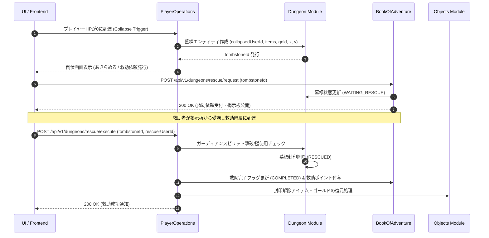

# ダンジョン救助・墓標システム (Dungeon Rescue & Tombstone System)

## 1. 概要
本ドキュメントは、プレイヤーがダンジョン探索中に HP が 0 になり倒伏（Collapse）した際、その場に「墓標（Tombstone）」を生成し、他のプレイヤー（または救助者）へ「救助依頼（Rescue Request）」を発行してアイテム・ゴールドの回収と復帰を図る「ダンジョン救助・墓標システム（Dungeon Rescue & Tombstone System）」の仕様を定義します。

本システムは、ローグライク特有のデスペナルティのリスクを非同期マルチプレイヤーの相互協力メカニズムによって緩和し、救助者には名誉・救助ポイント・専用報酬を提供するソーシャル・コミュニティ機能です。

---

## 2. 救助・墓標メカニズム (Rescue & Tombstone Mechanics)

### 2.1 倒伏と墓標の生成
1. **倒伏発生条件**: ダンジョン探索中にプレイヤーの HP が 0 に到達した際、即時ロスト処理（デスペナルティ適用）に代わり「倒伏状態」へ移行します。
2. **墓標 (Tombstone) エンティティの設置**: プレイヤーが倒伏した階層・座標に `Tombstone` オブジェクトが生成されます。
   - 墓標には、倒伏時に所持していたアイテム（`ThingInstance`）およびゴールド（`Gold`）が保護状態でカプセル化されます。
   - 墓標の周囲 8 マスには、プレイヤーを倒したモンスターや迷宮の怨念に基づく「ガーディアン・スピリット（怨念の守護霊）」が自動配置されます。

### 2.2 救助依頼の発行と公開
倒伏したプレイヤーは以下のいずれかを選択します。
- **あきらめる (Give Up)**: 設定されたデスペナルティに従い、所持品・ゴールドを没収されて街へ戻る。
- **救助依頼を発行する (Publish Rescue Request)**: `rescueRequestDomain` に救助依頼を作成し、パブリック救助掲示板へ公開する。

#### 救助依頼の有効期限と回数制限
- **有効期限**: 救助依頼発行から 48 時間（期限切れ時は自動的に「あきらめる」と同じデスペナルティが適用されます）。
- **依頼回数制限**: 1 回のダンジョン潜入につき最大 3 回まで救助依頼を発行可能。

### 2.3 救助遠征とガーディアン戦
1. **救助の受諾**: 他のプレイヤー（救助者）は、救助掲示板から公開された救助依頼を受諾します。
2. **救助ダンジョンへの潜入**: 救助者は、対象ダンジョンの同階層へ「救助遠征モード」で入場します。
3. **墓標の解放条件**:
   - 墓標の存在する階層に到達し、墓標に隣接します。
   - 墓標周囲に配置されたガーディアン・スピリットを全滅させるか、専用アイテム「供物のお香（`offering_incense`）」または「墓標のカギ（`tombstone_key`）」を消費することで、墓標の封印を解除します。

### 2.4 救助成功・失敗と報酬獲得
- **救助成功時 (Rescue Success)**:
  - 倒伏していたプレイヤーに通知（SSE / メール等）が送信され、没収予定だったアイテム・ゴールドが全額（または救助設定割合）復元されます。
  - 救助者には「救助ポイント（Rescue Points）」および「名誉の証（救助の感謝状等）」が付与され、実績・称号の条件としてカウントされます。
- **救助失敗時 (Rescue Failure)**:
  - 救助者が救助遠征中に倒伏した場合、救助失敗となります（依頼は他の救助者へ再度開放されます）。

---

## 3. ドメインモデル仕様 (Domain Models)

### 3.1 `TombstoneDomain` (墓標ドメイン)
```java
public record TombstoneDomain(
    String tombstoneId,
    String dungeonId,
    int floorLevel,
    Coordinate2D coordinate,
    String collapsedUserId,
    String collapsedUserName,
    List<ThingInstanceDomain> EncapsulatedItems,
    int EncapsulatedGold,
    TombstoneStatusEnum status,
    LocalDateTime createdAt,
    LocalDateTime expiresAt
) {}

public enum TombstoneStatusEnum {
    WAITING_RESCUE,   // 救助待ち
    RESCUE_IN_PROGRESS,// 救助進行中
    RESCUED,          // 救助完了
    ABANDONED,        // 放置・諦め
    EXPIRED           // 期限切れ
}
```

### 3.2 `RescueRequestDomain` (救助依頼ドメイン)
```java
public record RescueRequestDomain(
    String requestId,
    String tombstoneId,
    String requesterUserId,
    String requesterUserName,
    String dungeonId,
    int floorLevel,
    String rescuerUserId,
    RescueRequestStatusEnum status,
    int rewardPoints,
    LocalDateTime createdAt,
    LocalDateTime expiresAt
) {}

public enum RescueRequestStatusEnum {
    OPEN,        // 募集中
    ASSIGNED,    // 担当者決定・遠征中
    COMPLETED,   // 救助成功・完了
    FAILED,      // 救助失敗
    CANCELLED    // 依頼取り消し
}
```

---

## 4. MongoDB 永続化仕様 (MongoDB Persistence)

### 4.1 `playerTombstoneDomain` コレクション仕様
- **モジュール**: `Dungeon`
- **コレクション名**: `playerTombstoneDomain`

```json
{
  "_id": "tombstone_uuid_001",
  "tombstoneId": "tombstone_uuid_001",
  "dungeonId": "dungeon_frontier_01",
  "floorLevel": 12,
  "coordinate": { "x": 15, "y": 20 },
  "collapsedUserId": "user_uuid_1001",
  "collapsedUserName": "アリス",
  "encapsulatedItems": [
    { "instanceId": "item_sword_01", "typeId": "iron_sword", "quantity": 1 }
  ],
  "encapsulatedGold": 1500,
  "status": "WAITING_RESCUE",
  "createdAt": "2026-03-31T10:00:00Z",
  "expiresAt": "2026-04-02T10:00:00Z"
}
```

#### 推奨インデックス
| インデックスキー | ユニーク | 目的・用途 |
| :--- | :---: | :--- |
| `{"tombstoneId": 1}` | **Yes** | 墓標 ID による直接参照 |
| `{"dungeonId": 1, "floorLevel": 1}` | No | 特定階層に存在する墓標一覧取得 |
| `{"collapsedUserId": 1, "status": 1}` | No | プレイヤーごとのアクティブ墓標検索 |

---

### 4.2 `rescueRequestDomain` コレクション仕様
- **モジュール**: `BookOfAdventure`
- **コレクション名**: `rescueRequestDomain`

```json
{
  "_id": "rescue_req_uuid_5001",
  "requestId": "rescue_req_uuid_5001",
  "tombstoneId": "tombstone_uuid_001",
  "requesterUserId": "user_uuid_1001",
  "requesterUserName": "アリス",
  "dungeonId": "dungeon_frontier_01",
  "floorLevel": 12,
  "rescuerUserId": "user_uuid_2002",
  "status": "ASSIGNED",
  "rewardPoints": 500,
  "createdAt": "2026-03-31T10:05:00Z",
  "expiresAt": "2026-04-02T10:05:00Z"
}
```

#### 推奨インデックス
| インデックスキー | ユニーク | 目的・用途 |
| :--- | :---: | :--- |
| `{"requestId": 1}` | **Yes** | 救助依頼 ID による直接検索 |
| `{"status": 1, "createdAt": -1}` | No | 募集中の最新救助依頼一覧の照会 |
| `{"requesterUserId": 1}` | No | 依頼主別の過去依頼・状態取得 |

---

## 5. モジュール間連携とシーケンスフロー (Data Flow & Sequence)



---

## 6. 救助専用アイテム定義 (Supporting Items)

[Objectsモジュール](./domain_models/Objects.md) に追加登録される救助システム専用アイテム一覧です。

| typeId | 名称 | カテゴリ | 標準価格 | 説明 |
| :--- | :--- | :--- | :---: | :--- |
| `rescue_scroll` | 救助の巻物 | SCROLL | 1,200 | 使用すると、同階層に存在する墓標の位置をマップ上に開示し、ガーディアンの攻撃力を弱体化させる巻物。 |
| `offering_incense` | 供物のお香 | CONSUMABLE | 800 | 墓標に捧げることで、ガーディアン・スピリットとの戦闘をスキップして即座に墓標を解放するお香。 |
| `tombstone_key` | 墓標のカギ | KEY | 2,500 | 固く閉ざされた高級な墓標を解呪し、カプセル化されたアイテムを傷つけずに完全回収する鍵。 |

---

## 7. API仕様 (API Specifications)

### 7.1 救助依頼作成 (`POST /api/v1/dungeons/rescue/request`)
倒伏したプレイヤーが自身の墓標に対する救助依頼を発行します。

#### リクエスト JSON スキーマ
```json
{
  "userId": "user_uuid_1001",
  "tombstoneId": "tombstone_uuid_001"
}
```

#### レスポンス JSON スキーマ (200 OK)
```json
{
  "status": "SUCCESS",
  "requestId": "rescue_req_uuid_5001",
  "tombstoneId": "tombstone_uuid_001",
  "dungeonId": "dungeon_frontier_01",
  "floorLevel": 12,
  "expiresAt": "2026-04-02T10:05:00Z",
  "message": "救助依頼を救助掲示板に公開しました。"
}
```

---

### 7.2 救助依頼一覧照会 (`GET /api/v1/dungeons/rescue/requests`)
掲示板に公開されている募集中の救助依頼を検索・取得します。

#### クエリパラメータ
- `status`: `OPEN` (デフォルト)
- `page`: 0
- `size`: 20

#### レスポンス JSON スキーマ (200 OK)
```json
{
  "requests": [
    {
      "requestId": "rescue_req_uuid_5001",
      "requesterUserId": "user_uuid_1001",
      "requesterUserName": "アリス",
      "dungeonId": "dungeon_frontier_01",
      "floorLevel": 12,
      "rewardPoints": 500,
      "createdAt": "2026-03-31T10:05:00Z",
      "expiresAt": "2026-04-02T10:05:00Z"
    }
  ],
  "totalElements": 1,
  "totalPages": 1
}
```

---

### 7.3 救助実行 (`POST /api/v1/dungeons/rescue/execute`)
救助者が墓標に到達し、救助アクション（ガーディアン討伐またはアイテム投入）を実行します。

#### リクエスト JSON スキーマ
```json
{
  "rescuerUserId": "user_uuid_2002",
  "tombstoneId": "tombstone_uuid_001",
  "useItemId": "offering_incense"
}
```

#### レスポンス JSON スキーマ (200 OK)
```json
{
  "status": "SUCCESS",
  "tombstoneId": "tombstone_uuid_001",
  "rescuedUserId": "user_uuid_1001",
  "rewardPointsGained": 500,
  "message": "供物のお香を捧げ、墓標の封印を解除しました！救助成功です。"
}
```

---

### 7.4 救助報酬・アイテム回収 (`POST /api/v1/dungeons/rescue/claim`)
救助されたプレイヤーが復元されたアイテム・ゴールドを回収します。

#### リクエスト JSON スキーマ
```json
{
  "userId": "user_uuid_1001",
  "tombstoneId": "tombstone_uuid_001"
}
```

#### レスポンス JSON スキーマ (200 OK)
```json
{
  "status": "SUCCESS",
  "restoredGold": 1500,
  "restoredItemCount": 1,
  "message": "救助感謝のお礼とともに、失われたアイテムとゴールドが全額復元されました。"
}
```

---

## 8. エラーハンドリング仕様 (Error Handling)

### 8.1 エラーレスポンス共通 JSON スキーマ
```json
{
  "errorCode": "TOMBSTONE_NOT_FOUND",
  "message": "指定された墓標が存在しないか、すでに処理されています。",
  "timestamp": "2026-03-31T12:00:00Z"
}
```

### 8.2 エラーコード一覧およびマッピング

| エラーコード | HTTPステータス | 発生条件・説明 |
| :--- | :---: | :--- |
| `TOMBSTONE_NOT_FOUND` | `404 Not Found` | 指定された `tombstoneId` がデータベースに存在しない場合。 |
| `RESCUE_REQUEST_EXPIRED` | `410 Gone` | 救助依頼の有効期限（48時間）が切れている場合。 |
| `ALREADY_RESCUED` | `400 Bad Request` | 対象の墓標がすでに他の救助者によって解放・救助済みの場合。 |
| `CANNOT_RESCUE_SELF` | `400 Bad Request` | 倒伏したプレイヤー自身が自分の救助依頼を受諾・実行しようとした場合。 |
| `RESCUE_FAILED` | `400 Bad Request` | ガーディアン・スピリットが残存しており墓標を開放できない場合。 |
| `INSUFFICIENT_RESCUE_ITEM` | `400 Bad Request` | 墓標解呪に必要な「供物のお香」や「墓標のカギ」を所持していない場合。 |
