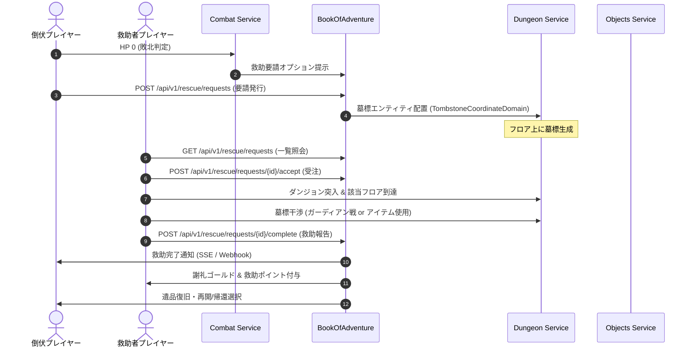

# ダンジョン救助・墓標システム仕様 (Dungeon Rescue & Tombstone System)

## 1. 概要
本ドキュメントは、ダンジョン探索中にプレイヤーが倒伏（HP 0 による死亡）した際に、全ロスや即時帰還を回避し、他プレイヤーへの救助要請や自身の再挑戦によって所持品・ゴールドを回収できる「ダンジョン救助・墓標システム」の仕様を定めます。

プレイヤーが倒れた地点には「墓標（Tombstone）」が生成され、救助者（または再挑戦時の本人）がそのフロアへ到達して墓標を守護する「ガーディアンスピリット（亡霊守護者）」を鎮める、あるいは特殊な救助アイテムを使用することで、救助を達成できます。

---

## 2. コアコンセプト・ゲームサイクル

### 2.1 倒伏と分岐選択
ダンジョン内で HP が 0 になったプレイヤーには、以下の 2 つの選択肢が提示されます。
1. **救助要請 (Call for Rescue)**:
   - 冒険者ギルドの救助掲示板に要請を発行し、待機状態に入ります。
   - 他のプレイヤーが救助隊としてダンジョンに突入し、対象フロアの墓標に到達・浄化することで救助されます。
   - 救助成功時、倒れたフロア・HP 満タン状態で冒険を再開するか、アイテム・ゴールドを失わずに街へ生還できます。
   - 同一ダンジョン探索につき最大 **3 回** まで要請可能。
2. **通常断念 (Give Up)**:
   - ダンジョンの標準デスペナルティ（[Dungeonモジュール ドメインモデル](./domain_models/Dungeon.md) 参照）を適用し、即座に街へリスポーンします。

### 2.2 墓標（Tombstone）エンティティ
- プレイヤーが倒れた座標に、ダンジョンフロア内オブジェクトとして「墓標（`TombstoneCoordinateDomain`）」が生成されます。
- 表示文字: `+` または `T` (Display レイヤー: `OBJECT`)。
- 墓標には倒れたプレイヤーの所持アイテムリスト（没収対象となったアイテム）およびロストゴールドの一部が封印されます。

### 2.3 ガーディアンスピリット（亡霊守護者）
- 救助者が墓標の周囲 1 マスに接近するか墓標に干渉すると、倒れた冒険者の無念やダンジョンの魔力が凝縮した「ガーディアンスピリット」が出現します。
- ガーディアンスピリットは倒れたプレイヤーのレベルおよびダンジョンランクに応じたステータスを持ち、これを撃破するか、後述の「供養のお香」で鎮静化させることで墓標の封印が解除されます。

---

## 3. 救助のフローとルール

### 3.1 救助隊の出撃
1. 冒険者ギルド（または街の掲示板）から公開中の「救助依頼一覧」を閲覧。
2. 救助対象ダンジョン、到達階層、倒伏者のレベル、提示報酬（ゴールド・救助ポイント）を確認し、依頼を受注。
3. 救助者は自身のパーティで対象ダンジョンへ出撃。対象フロアへ到達する。

### 3.2 墓標の浄化と救助完了
墓標を浄化する方法は以下の通りです。
- **戦闘による撃破**: 出現したガーディアンスピリットを撃破する。
- **救助アイテムの使用**:
  - `rescue_scroll`（救助の巻物）: 墓標の前で使用することで即座に救助を完了し、倒伏プレイヤーを蘇生。
  - `offering_incense`（供養のお香）: ガーディアンスピリットを戦わずに成仏させ、墓標を浄化。
  - `tombstone_key`（墓標の鍵）: 封印された遺品ボックスを開錠し、アイテムを確実に回収。

### 3.3 救助報酬
- **救助者への報酬**:
  - 依頼人が設定した謝礼ゴールド（依頼発行時にデポジット）。
  - 冒険者ギルドから支給される「ギルド名声ポイント（救助ポイント）」および名誉称号。
- **被救助者の復帰**:
  - 救助完了通知を受け取ると、ロストしたアイテムとゴールドを全額手元に取り戻し、探索をその階層から継続するか安全に帰還するかを選択。

---

## 4. サポートアイテム仕様

| アイテムID | 名称 | カテゴリ | 属性 | 価格 | ティア | 説明 |
| :--- | :--- | :---: | :---: | :---: | :---: | :--- |
| `rescue_scroll` | 救助の巻物 | `SCROLL` | Holy | 1500 | 2 | 対象フロアの墓標に向けて使用することで、スピリットを祓い即座に倒伏者を救助する。 |
| `offering_incense` | 供養のお香 | `OTHER` | None | 800 | 2 | 墓標の前に供えることで、亡霊守護者を戦闘なしで成仏させ墓標を浄化する。 |
| `tombstone_key` | 墓標の鍵 | `OTHER` | None | 1200 | 2 | 墓標に封印された倒伏者のアイテムおよびゴールドを無傷で開錠・回収する。 |

---

## 5. モジュール間連携シーケンス



---

## 6. API仕様 (API Specifications)

### 6.1 救助要請の発行 (`POST /api/v1/rescue/requests`)
倒伏したプレイヤーが救助要請を掲示板へ発行します。

#### リクエスト JSON スキーマ
```json
{
  "userId": "user_victim_01",
  "dungeonId": "dungeon_frontier_01",
  "floorLevel": 7,
  "deathCoordinate": { "x": 14, "y": 20, "z": 0 },
  "rewardGold": 1000,
  "message": "7Fのモンスターハウスで倒れました！どなたか助けてください！"
}
```

#### レスポンス JSON スキーマ (201 Created)
```json
{
  "rescueRequestId": "rescue_req_8849102",
  "userId": "user_victim_01",
  "dungeonId": "dungeon_frontier_01",
  "floorLevel": 7,
  "rewardGold": 1000,
  "status": "OPEN",
  "createdAt": "2026-03-31T12:00:00Z",
  "expiresAt": "2026-04-02T12:00:00Z"
}
```

---

### 6.2 救助要請一覧の照会 (`GET /api/v1/rescue/requests`)
救助掲示板に登録されている未完了の救助依頼一覧を取得します。

#### クエリパラメータ
- `dungeonId`: ダンジョンID（任意）
- `status`: 依頼状態（`OPEN`, `IN_PROGRESS`、任意）

#### レスポンス JSON スキーマ (200 OK)
```json
{
  "total": 1,
  "requests": [
    {
      "rescueRequestId": "rescue_req_8849102",
      "userId": "user_victim_01",
      "userName": "アリス",
      "dungeonId": "dungeon_frontier_01",
      "dungeonName": "試練の洞窟",
      "floorLevel": 7,
      "rewardGold": 1000,
      "status": "OPEN",
      "message": "7Fのモンスターハウスで倒れました！どなたか助けてください！",
      "createdAt": "2026-03-31T12:00:00Z"
    }
  ]
}
```

---

### 6.3 救助依頼の引き受け (`POST /api/v1/rescue/requests/{rescueRequestId}/accept`)
救助者が指定された救助要請を受注します。

#### リクエスト JSON スキーマ
```json
{
  "rescuerId": "user_rescuer_99"
}
```

#### レスポンス JSON スキーマ (200 OK)
```json
{
  "rescueRequestId": "rescue_req_8849102",
  "rescuerId": "user_rescuer_99",
  "status": "IN_PROGRESS",
  "acceptedAt": "2026-03-31T12:10:00Z"
}
```

---

### 6.4 救助完了の報告 (`POST /api/v1/rescue/requests/{rescueRequestId}/complete`)
救助者が対象墓標を浄化し、救助を完了したことを報告します。

#### リクエスト JSON スキーマ
```json
{
  "rescuerId": "user_rescuer_99",
  "resolutionType": "COMBAT_VICTORY"
}
```

#### レスポンス JSON スキーマ (200 OK)
```json
{
  "rescueRequestId": "rescue_req_8849102",
  "rescuerId": "user_rescuer_99",
  "status": "COMPLETED",
  "rewardGoldClaimed": 1000,
  "rescuePointsAwarded": 150,
  "completedAt": "2026-03-31T12:35:00Z"
}
```

---

## 7. エラーハンドリング仕様 (Error Handling Specification)

### 7.1 エラーコード一覧およびマッピング

| エラーコード | HTTPステータス | 発生条件・説明 |
| :--- | :---: | :--- |
| `RESCUE_REQUEST_NOT_FOUND` | `404 Not Found` | 指定された救助要請IDが存在しない場合。 |
| `RESCUE_LIMIT_EXCEEDED` | `400 Bad Request` | 同一ダンジョン探索での救助要請回数制限（最大3回）を超過した場合。 |
| `INSUFFICIENT_REWARD_GOLD` | `400 Bad Request` | 救助謝礼ゴールドのデポジットに必要な所持金が不足している場合。 |
| `REQUEST_ALREADY_ACCEPTED` | `409 Conflict` | 対象の救助要請がすでに他のプレイヤーに受注されている場合。 |
| `CANNOT_RESCUE_SELF` | `400 Bad Request` | 自分自身の救助要請を受注しようとした場合。 |
| `RESCUE_EXPIRED` | `410 Gone` | 救助要請の有効期限（発行から48時間）が切れている場合。 |
| `TOMBSTONE_NOT_PURIFIED` | `422 Unprocessable Entity` | 墓標のガーディアンが未撃破または未浄化の状態で完了報告が行われた場合。 |
| `UNAUTHORIZED_RESCUE_ACTION` | `403 Forbidden` | 受注していない救助者が完了報告を行おうとした場合。 |

### 7.2 エラーレスポンス共通 JSON スキーマ例
```json
{
  "errorCode": "REQUEST_ALREADY_ACCEPTED",
  "message": "この救助依頼はすでに他の冒険者に引き受けられています。",
  "status": 409,
  "timestamp": "2026-03-31T12:15:00Z"
}
```
