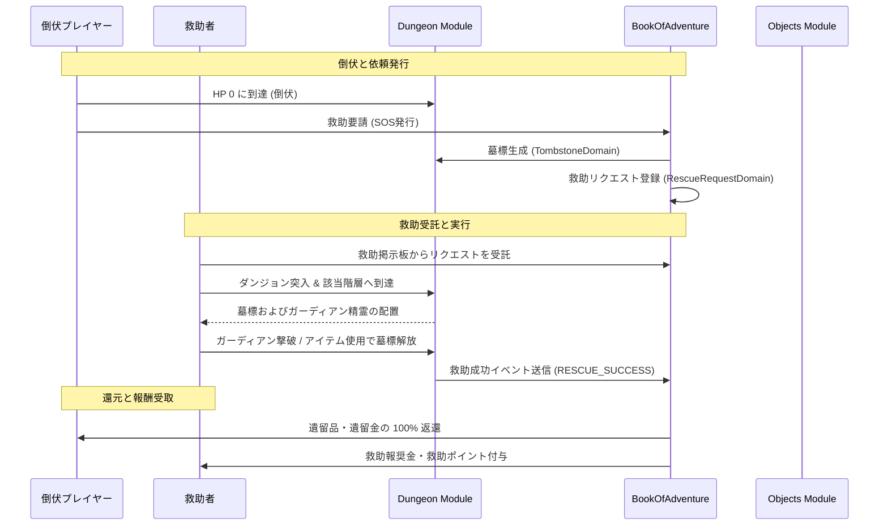

# ダンジョン救助＆墓標システム (Dungeon Rescue & Tombstone System)

## 1. 概要
本ドキュメントは、ダンジョン内で HP 0 となり倒伏（倒脱）したプレイヤーを他プレイヤーまたは仲間モンスターが救援・復旧するための「ダンジョン救助＆墓標システム」の仕様を定義します。
本システムは、ローグライクにおける全ロストの絶望感を軽減し、プレイヤー間の非同期協力・マルチプレイ体験およびダンジョン探索の循環を活性化することを目的とします。

## 2. プレイヤー倒伏と墓標メカニズム (Player Collapse & Tombstone Mechanics)

### 2.1 倒伏時の挙動
ダンジョン攻略中、プレイヤーの HP が 0 に到達すると即座にゲームオーバーとはならず、「倒伏状態（Collapsed State）」へ遷移します。
1. **救助選択ダイアログの表示**:
   - プレイヤーは「救助を要請する（SOS発行）」または「救助を諦めて帰還する（デスペナルティ適用）」を選択します。
2. **墓標（Tombstone）の生成**:
   - 「救助を要請する」を選択した場合、倒伏したフロアの該当座標に「墓標（`Tombstone`）」エンティティが生成・配置されます。
   - 墓標には、倒伏時に所有していた所持品（アイテム）および所持金（ゴールド）が安全に保管・封印されます。
   - 倒伏したプレイヤーはセッションを離脱し、町（安全地帯）へ一時帰還（仮死帰還）します。救助が成功するまで、該当ダンジョンへの再挑戦または救助待ち状態となります。

### 2.2 墓標（Tombstone）の属性仕様
`TombstoneDomain` で管理される主な属性は以下の通りです。

| 属性名 | 型 | 説明 |
| :--- | :--- | :--- |
| `tombstoneId` | String | 墓標の一意な識別子。 |
| `ownerUserId` | String | 倒伏したプレイヤーのユーザー ID。 |
| `dungeonId` | String | 倒伏が発生したダンジョンの ID。 |
| `floorLevel` | Integer | 倒伏が発生した階層レベル。 |
| `coordinate` | Coordinate | 墓標が配置された座標 `(x, y)`。 |
| `sealedItems` | List\<ThingInstanceDomain\> | 封印・保管されている遺留品アイテムリスト。 |
| `sealedGold` | Integer | 封印・保管されている遺留金。 |
| `guardianMonsterId` | String | 墓標を守護するガーディアン精霊/モンスターの種族 ID。 |
| `status` | Enum | `SEALED`（封印中/救助待ち）, `IN_RESCUE`（救助中）, `RESCUED`（救助完了）, `EXPIRED`（期限切れ/風化）。 |
| `createdAt` | Timestamp | 墓標生成タイムスタンプ。 |
| `expiresAt` | Timestamp | 救助有効期限（生成から 48 時間後）。 |

## 3. 救助リクエストと掲示板 (Rescue Request & Board System)

### 3.1 救助依頼の発行と掲示板登録
救助を要請すると、`BookOfAdventure` モジュールの救助掲示板に「救助リクエスト（`RescueRequest`）」が自動登録されます。
- **公開設定**: 「全体公開（誰でも救助可能）」、「ギルド/フレンド限定」、「非公開（パスフレーズ指定）」を選択できます。
- **受託制限**: 1 つの救助リクエストを受託できるのは同時に 1 名のプレイヤーのみです（二重受託の防止）。
- **有効期限**: リクエスト発行から 48 時間経過するとリクエストは `EXPIRED` となり、墓標は風化して封印品の一部がロスト（デスペナルティ適用時の還元率に低下）した状態で町へ郵送されます。

## 4. 救助探索とガーディアン戦 (Rescue Expedition & Guardian Battle)

### 4.1 救助探索の進行
救助を引き受けたプレイヤー（救助者）は、対象のダンジョン・階層へ突入します。
- **特殊フロア生成**: 救助者が対象階層に到達すると、倒伏者の墓標が生成されたマップレイアウトが再現されます。
- **視界・コンパス表示**: 救助者の画面 UI には墓標の方向を示すコンパスアイコンが表示されます。

### 4.2 ガーディアン精霊（Guardian Spirit）戦
墓標に接近すると、倒伏者の執念とダンジョンのマナが結合した「ガーディアン精霊（または墓標の番人）」が出現します。
- **ガーディアンの強さ**: 倒伏者のレベルおよび倒伏階層の難易度に比例してステータスが補正されます。
- **解放条件**: ガーディアン精霊を撃破するか、特殊アイテム「奉納のお香 (`offering_incense`)」または「墓標の鍵 (`tombstone_key`)」を使用することで墓標の封印を解くことができます。

## 5. 救助報酬と回収率 (Rewards & Recovery Rates)

### 5.1 救助成功時の還元と報酬
救助者が墓標を解放し、救助を完了させると以下の処理が実行されます。

1. **倒伏者（依頼者）への還元**:
   - **アイテム還元率**: 所持品アイテムの **100%** が完全に還元されます（全ロスト回避）。
   - **ゴールド還元率**: 所持金の **90%〜100%** が還元されます（10% はシステム手数料または救助者への報奨金）。
2. **救助者への報奨**:
   - **救助ポイント / 冒険者経験値**: ダンジョン難易度および階層に応じた特別救助ポイントを獲得。
   - **救助金（謝礼）**: 依頼者が設定した報酬金（またはシステムからの報奨金）を受け取ります。
   - **名声・称号**: 救助回数に応じた称号（[プレイヤー称号・実績システム](./Player-Title-Achievement-System.md) 参照）が解禁されます。

## 6. 救助専用消費アイテム (Rescue Dedicated Items)

`Objects` モジュールで管理される、救助システム専用のアイテムです。

| アイテム ID | 名称 | 種別 | 効果・用途 | 標準価格 |
| :--- | :--- | :--- | :--- | :---: |
| `rescue_scroll` | 救助の巻物 | 消費 (`SCROLL`) | 使用すると、救助依頼が出されているダンジョンの該当階層へ直接ワープする陣を生成します。 | 1,500 G |
| `offering_incense` | 奉納のお香 | 消費 (`CONSUMABLE`) | 墓標の前で使用すると、ガーディアン精霊との戦闘を回避して即座に墓標を解放します。 | 2,000 G |
| `tombstone_key` | 墓標の鍵 | 耐久消費 (`KEY`) | 墓標の封印を解除するために必要な特殊な鍵。消費して確実に墓標を開封します。 | 800 G |

## 7. モジュール間連携



## 8. APIリクエスト・フローとエラーハンドリング

### 8.1 APIリクエスト仕様

#### 1) 救助リクエスト発行 (`POST /api/v1/dungeons/rescue/request`)
- **Request Body (JSON)**:
```json
{
  "userId": "user_collapsed_12345",
  "dungeonId": "dungeon_frontier_01",
  "floorLevel": 5,
  "privacyType": "PUBLIC",
  "rewardGold": 1000,
  "passcode": ""
}
```

- **Response Body (JSON - 成功時)**:
```json
{
  "success": true,
  "result": "SUCCESS",
  "message": "救助リクエストを発行しました。",
  "rescueRequestId": "rescue_req_998877",
  "tombstoneId": "tombstone_uuid_112233",
  "expiresAt": "2026-04-02T12:00:00Z"
}
```

#### 2) 救助リクエスト一覧取得 (`GET /api/v1/dungeons/rescue/requests`)
- **Request Parameters**: `dungeonId` (任意), `status` (任意: `PENDING`), `page` (デフォルト 1)
- **Response Body (JSON - 成功時)**:
```json
{
  "success": true,
  "requests": [
    {
      "rescueRequestId": "rescue_req_998877",
      "requesterUserId": "user_collapsed_12345",
      "dungeonId": "dungeon_frontier_01",
      "floorLevel": 5,
      "rewardGold": 1000,
      "privacyType": "PUBLIC",
      "status": "PENDING",
      "createdAt": "2026-03-31T12:00:00Z",
      "expiresAt": "2026-04-02T12:00:00Z"
    }
  ]
}
```

#### 3) 救助受託 (`POST /api/v1/dungeons/rescue/accept`)
- **Request Body (JSON)**:
```json
{
  "userId": "user_helper_67890",
  "rescueRequestId": "rescue_req_998877",
  "passcode": ""
}
```

- **Response Body (JSON - 成功時)**:
```json
{
  "success": true,
  "result": "SUCCESS",
  "message": "救助依頼を受託しました。",
  "rescueRequestId": "rescue_req_998877",
  "targetDungeonId": "dungeon_frontier_01",
  "targetFloorLevel": 5
}
```

#### 4) 救助実行・墓標解放 (`POST /api/v1/dungeons/rescue/execute`)
- **Request Body (JSON)**:
```json
{
  "userId": "user_helper_67890",
  "tombstoneId": "tombstone_uuid_112233",
  "method": "DEFEAT_GUARDIAN",
  "usedItemId": ""
}
```

- **Response Body (JSON - 成功時)**:
```json
{
  "success": true,
  "result": "SUCCESS",
  "message": "墓標の封印を解放し、救助に成功しました！",
  "tombstoneId": "tombstone_uuid_112233",
  "recoveredItemsCount": 8,
  "recoveredGold": 2500,
  "earnedRewardGold": 1000,
  "earnedRescuePoints": 150
}
```

### 8.2 エラーハンドリング (Error Handling)

| エラーコード | 発生条件 | レスポンス HTTP ステータス | 戻り値のメッセージ例 |
| :--- | :--- | :---: | :--- |
| `RESCUE_REQUEST_NOT_FOUND` | 指定された `rescueRequestId` が存在しない。 | 404 Not Found | 指定された救助リクエストが見つかりません。 |
| `TOMBSTONE_NOT_FOUND` | 指定された `tombstoneId` が存在しない。 | 404 Not Found | 指定された墓標が見つかりません。 |
| `TOMBSTONE_ALREADY_RESCUED` | 既に他のプレイヤーによって救助・解放されている。 | 400 Bad Request | この墓標は既に救助済みです。 |
| `RESCUE_ALREADY_ACCEPTED` | 他の救助者が受託中の救助依頼を受託しようとした。 | 409 Conflict | この救助依頼は既に他のプレイヤーが受託しています。 |
| `INVALID_PASSCODE` | 非公開救助依頼のパスフレーズが一致しない。 | 401 Unauthorized | パスフレーズが一致しません。 |
| `RESCUE_EXPIRED` | 救助有効期限（48時間）が切れている。 | 400 Bad Request | 救助の有効期限が切れています。 |
| `CANNOT_RESCUE_SELF` | 自身の墓標/救助依頼を自身で受託・解放しようとした。 | 400 Bad Request | 自分の救助依頼を自分自身で受託することはできません。 |
