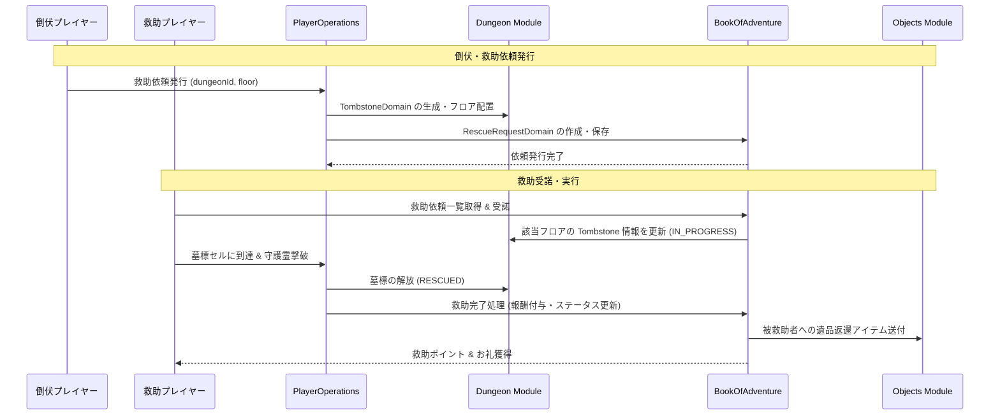

# ダンジョン救助・墓標システム (Dungeon Rescue & Tombstone System)

## 1. 概要
本ドキュメントは、プレイヤーがダンジョン内で倒れた際（全滅時）に「墓標（Tombstone）」が形成され、他のプレイヤーまたはフレンドに救助依頼（Rescue Request）を発行してアイテムやゴールドを回収・復活できる「ダンジョン救助・墓標システム」の仕様を定義します。本機能はプレイヤー間の協力インセンティブを高め、デス時の損失軽減とコミュニティ活性化を両立させます。

## 2. 墓標メカニズム (Tombstone Mechanics)

### 2.1 墓標の生成条件
- **倒伏時の処理**: プレイヤーがダンジョン内で HP 0 となった際、死亡ペナルティ（アイテム・ゴールド没収）が即座に確定する前に、「救助要請」を選択可能になります。
- **墓標エンティティの設置**: 救助要請を選択した場合、倒れた該当ダンジョンの階層・座標に `TombstoneDomain`（墓標オブジェクト）が生成されます。
- **墓標の所有データ**: 墓標には、プレイヤーが倒伏時に所持していたアイテムの一部または全額のゴールド、およびプレイヤーの記憶残渣（ガーディアン精神体）が保持されます。

### 2.2 墓標の有効期限と風化
- **有効期限**: 墓標の維持期間は生成から **72 時間 (リアルタイム)** です。
- **期限切れ（風化）**: 期限内に救助されなかった場合、墓標は風化して消滅します。没収されたアイテムおよびゴールドは管理者のダンジョン収益/ドロッププールへ還元されます。

## 3. 救助依頼フロー (Rescue Request Flow)

### 3.1 依頼の発行と公開
- **依頼形式**:
    - **全体公開依頼 (Public Request)**: 救助掲示板に掲示され、不特定多数の冒険者が受諾可能。
    - **フレンド指名依頼 (Direct Friend Request)**: 特定のフレンドプレイヤーを指定して送付。
- **依頼回数制限**: 1回の倒伏につき、救助依頼を行えるのは最大 **3 回まで**（救助失敗時の再依頼を含む）。

### 3.2 救助の受諾と派遣
- **救助者の条件**: 該当ダンジョンの該当階層まで到達可能な進行度を持つプレイヤー。
- **同時受諾制限**: 1人の救助者が同時に受けられる救助任務は最大 3 件まで。

## 4. 救助探索およびガーディアン戦 (Rescue Expedition & Guardian Spirit Battle)

### 4.1 救助フロアへの侵入
- 救助者は、対象のダンジョンに入場し、倒伏者が倒れた階層まで到達する必要があります。
- 特殊アイテム「救助の巻物 (`rescue_scroll`)」を使用することで、墓標が存在するフロアへ直接ワープすることが可能です。

### 4.2 墓標の守護霊（ガーディアン）戦
- 墓標の置かれたセルに到達すると、倒伏者の執念が実体化した「墓標の守護霊（Guardian Spirit）」との戦闘が発生します。
- **守護霊のステータス**: 倒伏したプレイヤーのレベルおよび攻撃力・防御力をベースに生成されるシャドウエンティティです。
- **勝利条件**: 守護霊を撃破することで墓標の封印が解除され、救助が成功します。

## 5. 報酬と復旧メカニズム (Rewards & Recovery)

### 5.1 倒伏者（被救助者）の特典
- **アイテム・ゴールドの復旧**: 没収予定だったアイテムの **80% 〜 100%**、およびゴールドの **90%** が還元されます。
- **その場復活 / 街への生還**: 倒伏者は「その場での復活（探索継続）」または「全復旧アイテムを持った状態で安全に街へ帰還」を選択できます。

### 5.2 救助者の報酬
- **救助ポイント (Rescue Points)**: 救助完了時に難易度・階層に応じた救助ポイントが付与されます。
- **特別名誉称号・アイテム**: 救助ポイントは専用ショップで限定装備、希少触媒、称号と交換可能です。
- **感謝の贈り物**: 被救助者がお礼として設定したゴールドまたはアイテムを受け取ることができます。

## 6. データ構造とドメインモデル

### 6.1 `TombstoneDomain` (値オブジェクト / エンティティ)
- **位置**: `Dungeon` モジュールの `FloorDomain` 内に保持されます。
- **プロパティ**:
    - `tombstoneId` (String): 墓標の一意な ID。
    - `ownerUserId` (String): 倒伏したプレイヤーのユーザー ID。
    - `ownerCharacterName` (String): 倒伏したプレイヤーのキャラクター名。
    - `position` (`Coordinate`): 墓標の設置座標。
    - `createdAt` (Long): 生成タイムスタンプ。
    - `expiresAt` (Long): 失効タイムスタンプ。
    - `status` (Enum: `WAITING`, `IN_PROGRESS`, `RESCUED`, `EXPIRED`): 救助状態。
    - `forfeitedItems` (List<ThingInstance>): 保管されている遺品アイテム。
    - `forfeitedGold` (Integer): 保管されている遺品ゴールド。
    - `guardianStats` (Object): 守護霊の戦闘ステータス。

### 6.2 `RescueRequestDomain` (ドメインエンティティ)
- **位置**: `BookOfAdventure` モジュールで管理されます。
- **プロパティ**:
    - `requestId` (String): 救助依頼の一意な ID。
    - `tombstoneId` (String): 該当する墓標の ID。
    - `requesterUserId` (String): 依頼者のユーザー ID。
    - `helperUserId` (String): 受諾した救助者のユーザー ID（未受諾時は null）。
    - `dungeonId` (String): 対象ダンジョン ID。
    - `floorLevel` (Integer): 対象階層。
    - `requestType` (Enum: `PUBLIC`, `DIRECT_FRIEND`): 依頼タイプ。
    - `status` (Enum: `OPEN`, `ASSIGNED`, `COMPLETED`, `FAILED`, `EXPIRED`): 依頼ステータス。
    - `rewardGold` (Integer): お礼のゴールド。
    - `createdAt` (Long): 作成日時。

## 7. モジュール間連携



## 8. APIリクエスト・フローとエラーハンドリング

### 8.1 APIリクエスト仕様

#### 1) 救助依頼発行 (`POST /api/v1/dungeons/rescue/request`)
- **Request Body (JSON)**:
```json
{
  "userId": "user_requester_123",
  "dungeonId": "dungeon_frontier_01",
  "floorLevel": 5,
  "requestType": "PUBLIC",
  "targetFriendUserId": null,
  "rewardGold": 500
}
```

- **Response Body (JSON - 成功時)**:
```json
{
  "success": true,
  "result": "SUCCESS",
  "requestId": "rescue_req_998877",
  "tombstoneId": "tombstone_554433",
  "expiresAt": "2026-04-03T12:00:00Z",
  "message": "救助依頼を発行しました。救助者の到着をお待ちください。"
}
```

#### 2) 救助依頼一覧取得 (`GET /api/v1/dungeons/rescue/requests`)
- **Query Parameters**: `dungeonId` (任意), `requestType` (任意), `page` (デフォルト 1), `limit` (デフォルト 20)
- **Response Body (JSON - 成功時)**:
```json
{
  "success": true,
  "requests": [
    {
      "requestId": "rescue_req_998877",
      "tombstoneId": "tombstone_554433",
      "requesterUserId": "user_requester_123",
      "requesterName": "アリス",
      "dungeonId": "dungeon_frontier_01",
      "dungeonName": "試練の洞窟",
      "floorLevel": 5,
      "rewardGold": 500,
      "createdAt": "2026-03-31T12:00:00Z",
      "expiresAt": "2026-04-03T12:00:00Z",
      "status": "OPEN"
    }
  ]
}
```

#### 3) 救助任務受諾 (`POST /api/v1/dungeons/rescue/dispatch`)
- **Request Body (JSON)**:
```json
{
  "helperUserId": "user_helper_456",
  "requestId": "rescue_req_998877"
}
```

- **Response Body (JSON - 成功時)**:
```json
{
  "success": true,
  "result": "SUCCESS",
  "requestId": "rescue_req_998877",
  "tombstoneId": "tombstone_554433",
  "targetFloorLevel": 5,
  "message": "救助任務を受諾しました。該当フロアへ向かってください。"
}
```

#### 4) 救助完了処理 (`POST /api/v1/dungeons/rescue/complete`)
- **Request Body (JSON)**:
```json
{
  "helperUserId": "user_helper_456",
  "tombstoneId": "tombstone_554433"
}
```

- **Response Body (JSON - 成功時)**:
```json
{
  "success": true,
  "result": "SUCCESS",
  "requestId": "rescue_req_998877",
  "earnedRescuePoints": 150,
  "earnedRewardGold": 500,
  "recoveredItemsCount": 4,
  "message": "救助が完了しました！救助ポイントとお礼を獲得しました。"
}
```

### 8.2 エラーハンドリング (Error Handling)

救助システムにおける異常発生時のエラーコードと HTTP ステータスコードのマッピングです。

| エラーコード | 発生条件 | レスポンス HTTP ステータス | 戻り値のメッセージ例 |
| :--- | :--- | :---: | :--- |
| `RESCUE_REQUEST_NOT_FOUND` | 指定された `requestId` の救助依頼が存在しない。 | 404 Not Found | 救助依頼が見つかりません。 |
| `TOMBSTONE_NOT_FOUND` | 指定された `tombstoneId` の墓標が存在しない、または既に消滅済み。 | 404 Not Found | 墓標が存在しないか、既に風化して消滅しました。 |
| `MAX_RESCUE_LIMIT_EXCEEDED` | 同一倒伏に対する救助依頼回数の上限（3回）を超過した。 | 400 Bad Request | この倒伏に対する救助依頼の上限回数を超過しています。 |
| `ALREADY_ASSIGNED` | 救助依頼が既に別の救助者によって受諾されている。 | 409 Conflict | 該当の救助依頼は既に別の冒険者に受諾されています。 |
| `CANNOT_RESCUE_SELF` | 自分自身の救助依頼を受諾しようとした。 | 400 Bad Request | 自分自身の救助依頼を受諾することはできません。 |
| `HELPER_CAPACITY_FULL` | 救助者が同時に受諾できる救助任務の上限（3件）を超過している。 | 400 Bad Request | 受諾可能な救助任務数の上限に達しています。 |
| `GUARDIAN_NOT_DEFEATED` | 墓標の守護霊を撃破せずに完了リクエストを送信した。 | 400 Bad Request | 墓標の守護霊がまだ撃破されていません。 |
| `RESCUE_REQUEST_EXPIRED` | 72 時間の有効期限が切れ、墓標が消滅済み。 | 410 Gone | 救助依頼の有効期限が切れています。 |

## 9. 今後の拡張
- **NPC 救助隊システム**: フレンドや他プレイヤーが救助に応じない場合、ゴールドを支払ってシステム NPC 救助隊を派遣できる仕組み。
- **ライバル救助競走**: 複数の救助者が同時に同じ墓標を目指してタイムアタックを行う競争モード。
