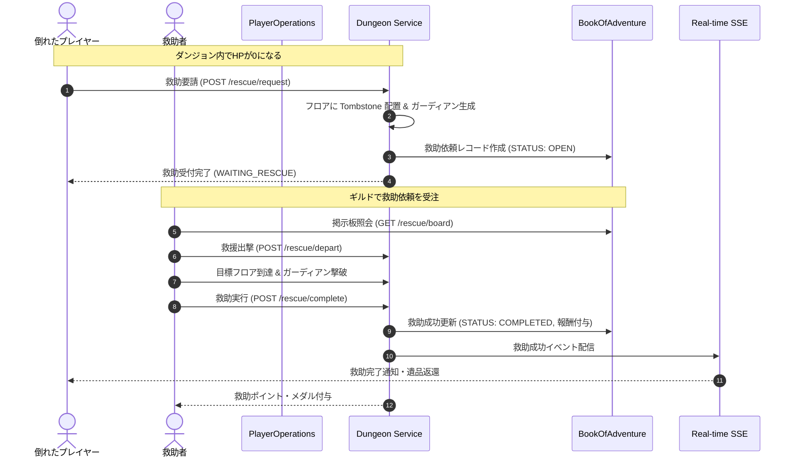

# ダンジョン救助・墓標システム仕様書 (Dungeon Rescue & Tombstone System)

このドキュメントは、ダンジョン探索中にプレイヤーが力尽きた（HPが0になった）際に、全損ペナルティを回避し他プレイヤーや自身の再挑戦によって所持品を回収可能にする**ダンジョン救助・墓標システム**の仕様について定義します。

---

## 1. システム概要

### 1.1 目的とコンセプト
従来のローグライクにおける「倒れたらすべてを失う」過酷なペナルティを緩和しつつ、マルチプレイヤー間のソーシャルな助け合いとエンドコンテンツ的な救助チャレンジ要素を提供します。
- **プレイヤーの救済**: 倒れたフロアに「墓標（Tombstone）」が生成され、救助要請を発行可能。救助が成功すれば、没収予定だったアイテムやゴールドを取り戻して探索を再開または帰還できる。
- **他プレイヤーの活躍の場**: 掲示板（救助掲示板）から他者の救助依頼を受注し、難関ダンジョンの特定階層へ出撃。救助に成功することで「救助ポイント」「救援メダル」「名誉称号」を獲得できる。
- **自己回収（リベンジ探索）**: 他プレイヤーに頼らず、自力で別パーティを編成して自身の墓標まで到達し、遺品を回収するソロプレイ救助もサポート。

---

## 2. 墓標生成と救助要請メカニズム

### 2.1 プレイヤー倒壊と墓標の設置
1. プレイヤーのHPが0になった際、通常の「即時死亡ペナルティ適用」を行うか、「救助要請（墓標設置）」を行うかを選択するダイアログが表示される。
2. 救助要請を選択した場合：
   - 倒れた座標に `Tombstone`（墓標オブジェクト）が生成される。
   - 墓標には、倒れたプレイヤーの所持アイテム（`forfeitedItems`）および所持ゴールド（`lostGold`）の一定割合（デフォルト: 80%）が封印・保管される。
   - 倒れたプレイヤーは一時的に「救助待ち状態（`WAITING_RESCUE`）」となり、ロビーや町で他コンテンツ（遠征、モンスター育成、他キャラ探索等）をプレイしながら救援を待つ。
3. 墓標設置の有効期限：
   - 生成から **72時間（実時間）**。有効期限が切れた場合、未回収の遺品は完全に消失し、通常死亡扱いとなる。

### 2.2 墓標ガーディアン（守護霊・未練の影）
墓標の周囲には、倒れたプレイヤーの無念やダンジョンの魔力が凝縮した「墓標ガーディアン（`Tombstone Guardian`）」が出現します。
- **ガーディアンの特性**: 倒れたプレイヤーのレベルおよび装備に基づきステータスがスケーリングされたモンスター、または特定種族のゴースト系エリートモンスター。
- **解放条件**: 墓標に接触してアイテムを回収するには、墓標ガーディアンを討伐するか、専用アイテム「供養の線香（`offering_incense`）」を使用して敵対心を鎮める必要がある。

---

## 3. 救助ミッションの受注と進行

### 3.1 救助掲示板（Rescue Board）
町や拠点のギルドに設置された「救助掲示板」から、公開されている救助依頼を閲覧・受注できます。
- **依頼情報**: 依頼者名、ダンジョン名、対象フロア、倒れた原因モンスター、難易度（危険度ランク）、報酬額。
- **受注制限**: 同時に受注できる救助依頼はプレイヤー1人につき最大 **3件** まで。

### 3.2 救援ダンジョンへの出撃
- 救助者は、対象ダンジョンの第1フロア（または中継拠点）からスタートし、目標階層を目指す。
- 目標フロアに到達すると、ミニマップ上に墓標アイコン（`⚰` または `T`）が表示される。
- 墓標タイルに到達し、以下のいずれかの方法で救助を完了する：
  1. **墓標の解放**: 周囲の墓標ガーディアンを殲滅し、墓標にアクセスして「救助の巻物（`rescue_scroll`）」を使用する。
  2. **供養と浄化**: 「供養の線香」を墓標に捧げ、戦闘を行わずに即時成仏・救助完了させる。

### 3.3 救助成功時の報酬と処理
1. **被救助者（依頼者）への還元**:
   - 救助完了の通知（SSEおよびゲーム内メッセージ）が届く。
   - 保管されていたアイテムおよびゴールドがすべてインベントリ（または倉庫）へ返却される。
   - デスペナルティ（経験値減少、レベルダウン）が完全に免除される。
2. **救助者への報酬**:
   - **救助ポイント（Rescue Points）**: 難易度や階層深さに応じたポイント（例: 階層 × 100 pt）。
   - **救援メダル（Rescue Medals）**: 特別な交換所で希少な装備、オーブ、外見称号と交換可能。
   - **依頼主からのお礼**: 依頼時に設定された謝礼金（ゴールド）および感謝の手紙。

---

## 4. シーケンスフロー



---

## 5. ドメインモデルおよびデータ構造

### 5.1 `TombstoneCoordinateDomain` (Dungeon モジュール)
フロア上に配置される墓標エンティティの位置と保持データを表します。

```java
public record TombstoneCoordinateDomain(
    Coordinate position,
    String tombstoneId,
    String rescueRequestId,
    String victimUserId,
    String victimUserName,
    long lostGold,
    List<String> preservedItemInstanceIds,
    String guardianMonsterInstanceId,
    boolean isPurified,
    long createdAt,
    long expiresAt
) {}
```

### 5.2 `RescueRequestDomain` (BookOfAdventure モジュール)
永続化される救助依頼ドキュメントです。

```java
public record RescueRequestDomain(
    String requestId,
    String victimUserId,
    String victimUserName,
    String dungeonId,
    String dungeonName,
    int floorLevel,
    Coordinate deathPosition,
    String causeOfDeath,
    long rewardGold,
    RescueStatus status, // OPEN, IN_PROGRESS, COMPLETED, EXPIRED, CANCELLED
    String rescuerUserId,
    long createdAt,
    long expiresAt,
    Long completedAt
) {}
```

---

## 6. REST API 仕様

### 6.1 救助要請の発行 (`POST /api/v1/dungeons/rescue/request`)
ダンジョン内で倒れたプレイヤーが墓標を設置し、救助依頼を発行します。

#### リクエスト (Request)
```json
{
  "dungeonId": "dungeon_trial_cave",
  "floorLevel": 7,
  "deathPosition": { "x": 14, "y": 18, "z": 0 },
  "causeOfDeath": "MONSTER_SKILL_FIREBREATH",
  "rewardGold": 1000
}
```

#### レスポンス (Response: 201 Created)
```json
{
  "requestId": "rescue_req_987654",
  "tombstoneId": "tomb_112233",
  "status": "OPEN",
  "victimUserId": "user_12345",
  "dungeonId": "dungeon_trial_cave",
  "floorLevel": 7,
  "preservedItemsCount": 8,
  "preservedGold": 2400,
  "rewardGold": 1000,
  "expiresAt": "2026-04-03T12:00:00Z"
}
```

---

### 6.2 救助掲示板の一覧照会 (`GET /api/v1/dungeons/rescue/board`)
現在受注可能な救助依頼一覧を取得します。

#### クエリパラメータ (Query Parameters)
- `dungeonId` (任意): 特定のダンジョンで絞り込み
- `minLevel` / `maxLevel` (任意): フロア階層範囲
- `limit` (デフォルト: 20)

#### レスポンス (Response: 200 OK)
```json
{
  "requests": [
    {
      "requestId": "rescue_req_987654",
      "victimUserId": "user_12345",
      "victimUserName": "アリス",
      "dungeonId": "dungeon_trial_cave",
      "dungeonName": "試練の洞窟",
      "floorLevel": 7,
      "causeOfDeath": "MONSTER_SKILL_FIREBREATH",
      "rewardGold": 1000,
      "estimatedDifficulty": "HARD",
      "status": "OPEN",
      "createdAt": "2026-03-31T12:00:00Z",
      "expiresAt": "2026-04-03T12:00:00Z"
    }
  ],
  "totalCount": 1
}
```

---

### 6.3 救助出撃の登録 (`POST /api/v1/dungeons/rescue/depart`)
救助者が特定の救助依頼を受注し、出撃状態に更新します。

#### リクエスト (Request)
```json
{
  "requestId": "rescue_req_987654",
  "rescuerUserId": "user_rescuer_01"
}
```

#### レスポンス (Response: 200 OK)
```json
{
  "requestId": "rescue_req_987654",
  "rescuerUserId": "user_rescuer_01",
  "dungeonId": "dungeon_trial_cave",
  "targetFloorLevel": 7,
  "departureTime": "2026-03-31T13:00:00Z",
  "status": "IN_PROGRESS"
}
```

---

### 6.4 救助実行・完了処理 (`POST /api/v1/dungeons/rescue/complete`)
目標フロアの墓標に到達し、救助アイテムを使用またはガーディアン撃破後に救助を完了します。

#### リクエスト (Request)
```json
{
  "requestId": "rescue_req_987654",
  "rescuerUserId": "user_rescuer_01",
  "tombstoneId": "tomb_112233",
  "usedItemId": "rescue_scroll"
}
```

#### レスポンス (Response: 200 OK)
```json
{
  "requestId": "rescue_req_987654",
  "status": "COMPLETED",
  "rescuerUserId": "user_rescuer_01",
  "victimUserId": "user_12345",
  "rewardSummary": {
    "rewardGold": 1000,
    "rescuePoints": 700,
    "rescueMedals": 3
  },
  "restoredItemsCount": 8,
  "restoredGold": 2400,
  "completedAt": "2026-03-31T13:45:00Z"
}
```

---

## 7. エラーハンドリング仕様

| エラーコード | HTTPステータス | 説明 | 発生条件 |
| :--- | :--- | :--- | :--- |
| `RESCUE_REQUEST_NOT_FOUND` | `404 Not Found` | 救助依頼非存在 | 指定された `requestId` の依頼が存在しない。 |
| `TOMBSTONE_NOT_FOUND` | `404 Not Found` | 墓標非存在 | 対象フロアに指定された墓標が見つからない。 |
| `REQUEST_ALREADY_ASSIGNED` | `409 Conflict` | 既受注エラー | 他のプレイヤーがすでに出撃・進行中である。 |
| `RESCUE_REQUEST_EXPIRED` | `410 Gone` | 期限切れエラー | 72時間の有効期限を超過している。 |
| `CANNOT_RESCUE_SELF_VIA_BOARD`| `400 Bad Request`| 自己掲示板受注不可 | 自身の救助依頼を掲示板経由で受注しようとした（自力回収は専用ソロ出撃で行う）。 |
| `ACTIVE_RESCUE_LIMIT_EXCEEDED`| `400 Bad Request`| 受注上限エラー | 同時に受注可能な上限数（3件）を超過している。 |
| `GUARDIAN_NOT_DEFEATED` | `400 Bad Request` | 未浄化エラー | 墓標ガーディアンが生存しており、供養アイテムも未使用。 |
| `ITEM_NOT_USABLE_FOR_RESCUE` | `400 Bad Request` | 不正救助アイテム | 救助用アイテム（`rescue_scroll`, `offering_incense` 等）以外のアイテムを指定した。 |
| `INSUFFICIENT_REWARD_GOLD` | `400 Bad Request` | 謝礼金不足 | 救助依頼発行時の所持ゴールドが指定謝礼金に満たない。 |
