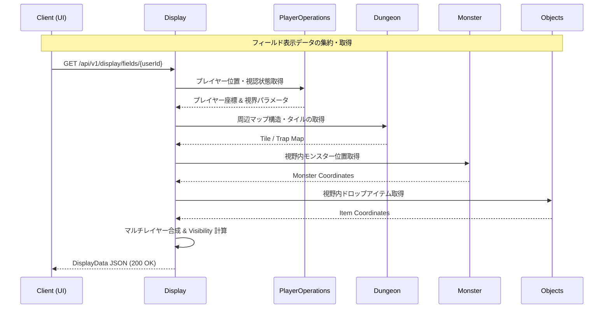

# Displayモジュール ドメインモデル

このドキュメントは、**Display**モジュールのコアとなるドメインモデルおよび表示・描画機能について説明します。

## 1. コアコンセプト

Displayモジュールは、プレイヤーのクライアント画面（フロントエンド/UI）に対して、ダンジョンマップ、エンティティ（プレイヤー、モンスター）、ドロップアイテム、トラップ、環境効果、視認範囲（Fog of War）、および演出オーバーレイ（ダメージテキスト、ヒットストップ、ステータスアイコン）を統合・構造化して提供する**表示・可視化レイヤー**です。

複数モジュール（`Dungeon`, `PlayerOperations`, `Monster`, `Objects`）に分散する描画要素を集約し、レイヤー順序（重ね合わせ）の調整や視認判定を行った上で、REST APIおよびSSE（Server-Sent Events）リアルタイムストリーム経由でクライアントへ配信します。

---

## 2. 主要なドメインオブジェクト

### `DisplayData<T>`
- **説明:** 画面上の1セル（座標）における表示情報を保持するジェネリック型オブジェクト。
- **プロパティ:**
    - `x`: マップの X 座標。
    - `y`: マップの Y 座標。
    - `displayLayers`: 各レイヤー (`LayerEnum`) に対応する表示文字またはスプライト識別子のリスト（重なり順）。
    - `visibility`: タイルの視認状態 (`VisibilityEnum`: `VISIBLE`, `EXPLORED_DARK`, `UNEXPLORED`)。

### `LayerEnum` (列挙型)
- **説明:** 描画の優先順位（重ね合わせ順序）を定義するレイヤー列挙型。数値が小さいものほど背面に描画されます。
- **値:**
    - `TILE` (0): 床・壁・水路・溶岩等の背景タイル。
    - `TRAP` (1): 露出したトラップタイル。
    - `OBJECT` (2): ドロップアイテム・宝箱・建造物。
    - `MONSTER` (3): 敵モンスター・NPC。
    - `PLAYER` (4): プレイヤーキャラクター。
    - `OVERLAY` (5): ヒット演出、ダメージポップアップ、状態異常アイコン。

### `FieldOverlayDomain`
- **説明:** 攻撃ヒットアニメーション、ダメージテキスト、画面揺れ（スクリーンシェイク）等の動的な視覚演出効果を表すドメインモデル。
- **プロパティ:**
    - `overlayId`: オーバーレイ一意 ID。
    - `userId`: 対象プレイヤー ID。
    - `coordinate`: 演出発火位置の X/Y 座標。
    - `type`: 演出タイプ (`DAMAGE_POPUP`, `HIT_EFFECT`, `SCREEN_SHAKE`, `STATUS_ICON`)。
    - `durationMs`: 演出の再生時間（ミリ秒）。
    - `parameters`: 演出詳細パラメータ（数値テキスト、シェイク強度、カラー等）。

### `FogOfWarDomain`
- **説明:** プレイヤーの現在位置および視認範囲（標準7マス、暗闇2マス等）に基づく各タイルの探索・可視状態。
- **プロパティ:**
    - `userId`: 対象プレイヤー ID。
    - `dungeonId`: 対象ダンジョン ID。
    - `floorNumber`: フロア階層。
    - `exploredTiles`: 探索済み（既知だが現在視界外）の座標セット。
    - `visibleTiles`: 現在直接視認可能な座標セット。

### `ViewportCoordinateDomain`
- **説明:** プレイヤーを中心に表示範囲（カメラ視野）を定義する値オブジェクト。
- **プロパティ:**
    - `centerX`: カメラ中心 X 座標。
    - `centerY`: カメラ中心 Y 座標。
    - `viewportWidth`: 視野幅（例: 15 マス）。
    - `viewportHeight`: 視野高さ（例: 15 マス）。

---

## 3. 主要なサービス

### `DisplayAggregationService`
- **説明:** `Dungeon`（マップ構造）、`PlayerOperations`（プレイヤー位置）、`Monster`（モンスター配置）、`Objects`（落ちているアイテム）の各サービスからデータを収集し、`DisplayData` のマルチレイヤー描画構造に統合します。

### `VisibilityService`
- **説明:** プレイヤーのステータス（不可視、暗闇、盲目）や環境効果（絶対零度、太陽フレア）を反映し、視認可能範囲（`FogOfWarDomain`）の判定計算を行います。

### `SseDisplayStreamService`
- **説明:** ダンジョン内で発生したリアルタイムな状態変更（プレイヤー移動、攻撃ヒット、状態異常付与等）を検知し、クライアントへ即座に SSE イベントストリームとしてプッシュ配信します。

---

## 4. API仕様

### 4.1 フィールド表示データ照会 (`GET /api/v1/display/fields/{userId}`)

指定したプレイヤーの視野領域（ビューポート）におけるマップ表示データを取得します。

#### リクエストパラメータ (Query Parameters)
- `width` (任意, default: 15): 視野幅
- `height` (任意, default: 15): 視野高さ

#### レスポンス (Response: 200 OK)
```json
{
  "userId": "user_12345",
  "dungeonId": "dungeon_frontier_01",
  "floorNumber": 3,
  "viewport": {
    "centerX": 10,
    "centerY": 14,
    "viewportWidth": 15,
    "viewportHeight": 15
  },
  "fields": [
    {
      "x": 10,
      "y": 14,
      "visibility": "VISIBLE",
      "displayLayers": [
        {
          "layer": "TILE",
          "display": "."
        },
        {
          "layer": "PLAYER",
          "display": "@"
        }
      ]
    },
    {
      "x": 11,
      "y": 14,
      "visibility": "VISIBLE",
      "displayLayers": [
        {
          "layer": "TILE",
          "display": "."
        },
        {
          "layer": "OBJECT",
          "display": "!"
        }
      ]
    }
  ]
}
```

---

### 4.2 演出・オーバーレイデータ照会 (`GET /api/v1/display/overlay/{userId}`)

現在描画待ちとなっているダメージテキストや画面シェイクなどの視覚演出オーバーレイ情報を取得します。

#### レスポンス (Response: 200 OK)
```json
{
  "userId": "user_12345",
  "overlays": [
    {
      "overlayId": "ov_9921",
      "coordinate": {
        "x": 11,
        "y": 14
      },
      "type": "DAMAGE_POPUP",
      "durationMs": 400,
      "parameters": {
        "damageValue": 24,
        "isCritical": false,
        "textColor": "#FF3333"
      }
    }
  ]
}
```

---

### 4.3 リアルタイム描画 SSE ストリーム (`GET /api/v1/display/stream/{userId}`)

ダンジョン内の視界変動、動的エンティティ移動、および演出発火をリアルタイムに受領するための SSE エンドポイントです。

#### SSE イベント配信形式例 (Server-Sent Event Payload)
```text
event: display_update
data: { "userId": "user_12345", "eventType": "MOVE", "targetX": 11, "targetY": 14, "consumedStamina": 1 }

event: overlay_trigger
data: { "userId": "user_12345", "eventType": "HIT_STOP", "durationMs": 60, "intensity": 1.2 }
```

---

## 5. エラーハンドリング仕様

Displayモジュールの処理実行時に発生する主要なエラーコードと対応するHTTPステータスコードです。

### 5.1 エラーコード一覧

| エラーコード | HTTPステータス | 説明 | 発生条件 |
| :--- | :--- | :--- | :--- |
| `PLAYER_NOT_FOUND` | `404 Not Found` | プレイヤー非存在 | 指定された `userId` のプレイヤーが存在しない。 |
| `DUNGEON_SESSION_NOT_FOUND` | `404 Not Found` | ダンジョンセッション非存在 | プレイヤーが現在アクティブなダンジョンに滞在していない。 |
| `INVALID_VIEWPORT_COORDINATE` | `400 Bad Request` | ビューポート座標不正 | 指定された視野範囲の幅・高さが負数または上限値（31x31）を超えている。 |
| `STREAM_CONNECTION_TIMEOUT` | `504 Gateway Timeout` | SSEストリームタイムアウト | クライアントとのSSE接続がタイムアウトまたは切断された。 |
| `UNAUTHORIZED_DISPLAY_ACCESS` | `403 Forbidden` | 閲覧権限エラー | 他のプレイヤーのプライベートな視界情報に対する不正アクセス。 |

### 5.2 エラーレスポンス形式例

```json
{
  "errorCode": "DUNGEON_SESSION_NOT_FOUND",
  "message": "指定されたプレイヤーはダンジョン内に滞在していません。",
  "status": 404,
  "timestamp": "2026-03-31T12:00:00Z"
}
```

---

## 6. モジュール間連携フロー

以下の図は、クライアントが描画データを要求・受領する際のモジュール間連携を示します。


